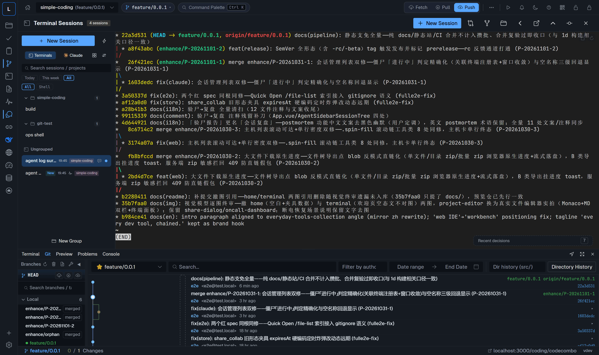
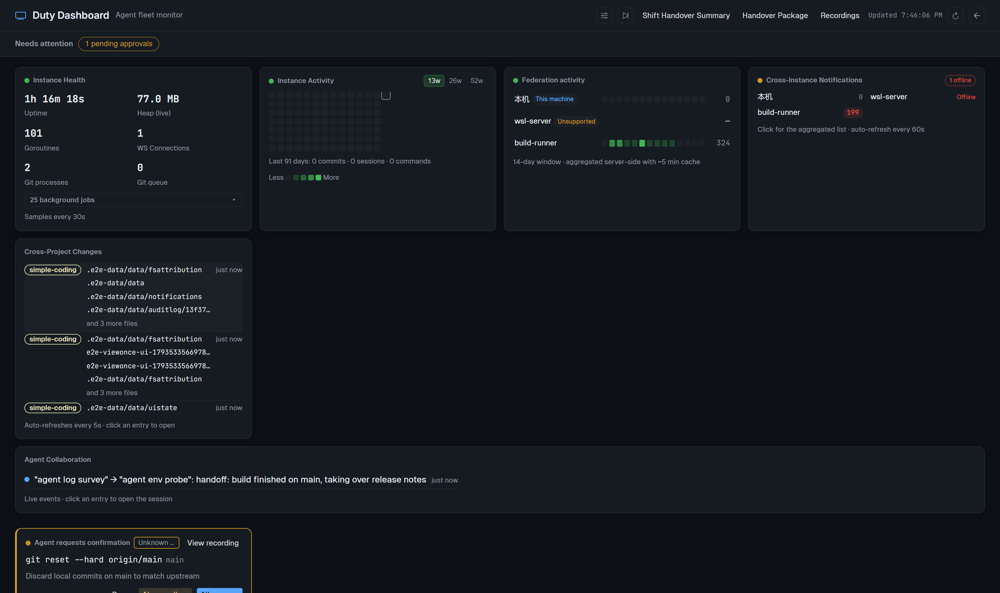
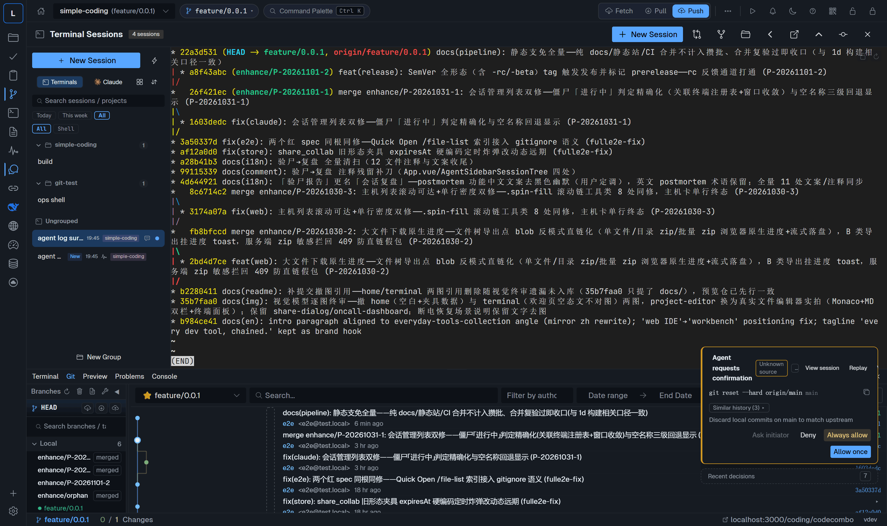
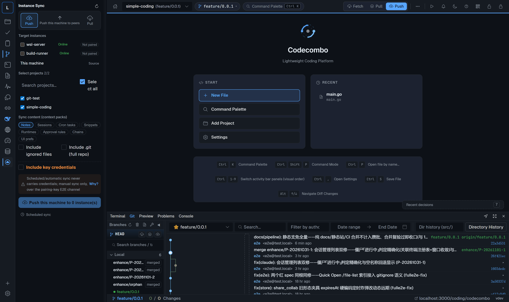
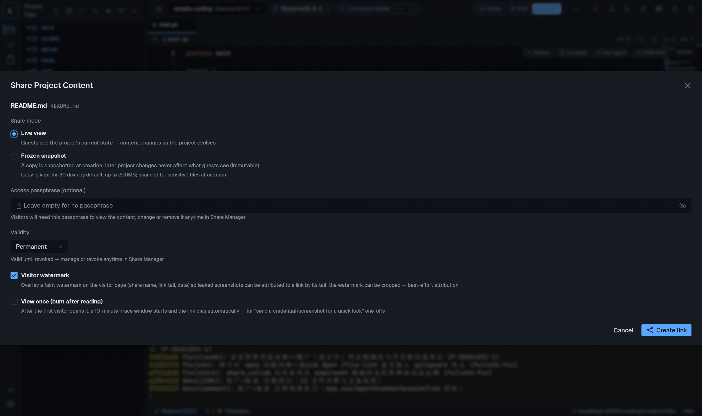
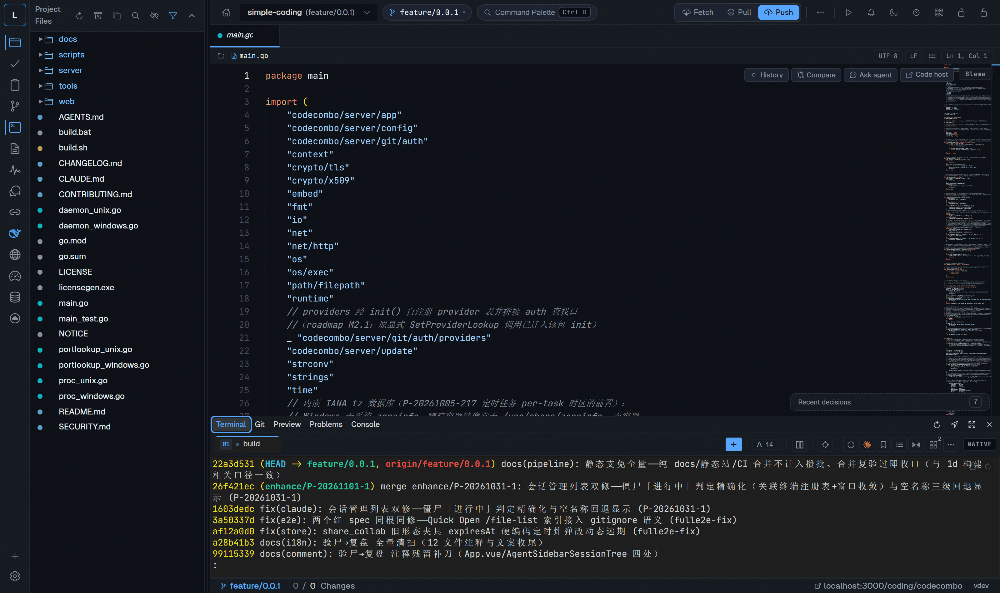

# Codecombo

**Language / 语言：English | [简体中文](docs/README.zh-CN.md)**


<!-- CI badge: uncomment after the first green run on GitHub Actions

-->

> **Status: Beta.** Codecombo is under active development and has not had its
> stable 1.0 release yet — interfaces and on-disk data formats may still change
> between versions. Feedback and bug reports are very welcome.

**Codecombo — every dev tool, chained.**

**Codecombo** is a self-hosted, single-binary workbench that collects your
everyday dev tools — a full Git workbench, real terminal sessions, AI coding
agents, remote machines — into one browser tab, where they share data and work
together. No more juggling separate apps.

- **One binary, no database** — Go (Gin) backend + Vue 3 (Naive UI) frontend
  embedded via `go:embed`; all state stays in `~/.codecombo/` on your machine.
- **Everything is a session** — local shells, remote SSH terminals, AI agents
  (claude / codex / dsh runtimes) live side by side in the same workspace.
- **Built for delegation with control** — agents can run autonomously, but
  high-risk actions come back to you as approval cards.

> **About dsh**: Codecombo neither includes nor distributes dsh (DeepSeek
> Harness) or any third-party agent runtime. It only ships an optional local
> embedding channel: if *you* installed dsh on your machine, Codecombo can
> embed its web UI over a loopback proxy. See [NOTICE](NOTICE).


## Highlights

### Agent ops channel

The part no other terminal has: agents do not just run *inside* Codecombo —
they can operate the workbench itself over a structured API. An agent can
trigger a browser download for a report it just produced, copy a snippet to
your clipboard, open a file at an exact line, focus a panel, publish a dev-server
preview link, or surface structured questions (ask cards) and high-risk action
requests (approval cards) back to you. Capabilities are registered in a single
registry with a rendered handbook (`GET /api/ops-manual`) agents can read, and
the same channel powers cross-device notifications.

### AI agent sessions

Run multiple AI agent sessions per project — side-by-side comparison of two
agents on the same task, session continuation chains (hand work from one agent
to the next), scheduled agent jobs, reusable runbooks, and fleet execution of a
runbook across many sessions. Every session is a real PTY: attach, replay the
full scrollback after a refresh, bookmark lines, and search across all output.



*Typical scenario: the server lost power or was rebooted mid-task. The terminal
processes are gone, but the work is not — open Codecombo and tell any agent over
the ops channel to "restore all my previous sessions": each project's sessions
come back the way they were, with full output history replayable.*

### On-call dashboard

A single screen for "what is my box doing right now": instance health (memory /
goroutines / WebSocket clients / git process pressure), a 52-week activity
heatmap, a cross-project live change stream, agent collaboration flow (who
messaged whom, which handoff chain is running), stalled-session triage, and
approval cards waiting for judgement.



### Approval center

Agents don't get a blank check. High-risk commands and mass file replacements
return as approval cards with live terminal recording — watch what the agent
did, then approve, deny, or edit per item. Sensitive values (tokens, passwords,
cloud keys) are redacted on the way out.



### Multi-instance sync

One Codecombo instance can manage many others — local or remote — through a
central proxy: instance switching with health overview, terminal and panel
take-over of a remote instance, instance-to-instance sync, and one-shot
machine migration (export/import an encrypted `.scpkg` package with
credentials, settings and project contexts).



### Sharing links

Share a file, a folder, a text snippet, or a live terminal with visitors via
one-click links — TTL, password, view-once (burn-after-reading) and
frozen-snapshot are all one toggle away; visitors need no account.



*Typical scenario: a colleague needs the report you just generated. Right-click
the file → Share → send the link. Done — no chat-tool file transfer, no shared
drive, and you can revoke the link at any moment.*

### …and a complete Git workbench

Staging down to the hunk level, three-way diffs, interactive rebase with
drag-and-drop, merge preview, changelists and shelves, conflict resolution,
worktrees, submodules, LFS, GPG-signed commits, reflog, patch export/import,
and a commit graph you can cherry-pick / squash / extract from.



## Highlights (continued): the rest of the toolbox

- **Web terminal** — real PTYs (ConPTY on Windows, creack/pty on Unix),
  optional tmux persistence with output replay across restarts, split panes,
  floating windows, image paste upload, bookmarks, command blocks.
- **Remote machines** — SSH host management with encrypted credentials,
  remote terminals (with remote tmux), one-click remote deployment pipelines
  (user bootstrap → Node.js/agent runtime → systemd service), live deploy
  logs, port forwarding.
- **Security foundation** — global lock (first-start password setup, idle
  auto-lock), AES-256 encryption for all stored secrets via a local master
  key, per-IP rate limiting, audit log with CSV export.
- **Self-update** — GitHub-release-based update checks with automatic
  rollback; central instances can cache and forward binaries to child
  instances.
- **i18n & themes** — English / 简体中文 UI; four built-in themes
  (Dark / Light / One Dark / Dracula).

## Quickstart

### Install with npm (fastest)

```bash
npm i -g codecombo
codecombo start
```

Then open **http://localhost:9999** and set your lock password on first start.
Requires Node.js 18+ — the npm package is a thin wrapper; `npm` picks the
native binary for your platform (Windows / Linux / macOS, amd64 & arm64) via
optional dependencies. No postinstall scripts. Prebuilt binaries are also on
the [Releases](../../releases) page.

### Build and run

Prerequisites: Go 1.26+, Node.js 20.19+ / 22.12+, Git.

```bash
git clone https://github.com/wtr20211202/codecombo.git
cd codecombo

./build.sh            # Linux/macOS — frontend + Go, output to dist/
build.bat             # Windows

./dist/codecombo start        # start the service (daemon)
# or: ./dist/codecombo        # equivalent to `start`
```

Then open **http://localhost:9999**, set your lock password on first start,
and add a project (a local Git repo, or clone one). Prebuilt binaries for
Windows / Linux / macOS (amd64 & arm64) are published on the
[Releases](../../releases) page.

### Development mode

```bash
cd web && npm install && npm run dev   # Vite dev server on :5173 (proxies to :9999)
go run main.go                         # Go backend on :9999 (second terminal)
```

Run the quality gates before submitting changes: `cd web && npm run check`
(type-check + lint + unit tests + contract gates) and `go test ./...`.

## Project structure

```
codecombo/
├── main.go                  # CLI entry (start/stop/update/reset-lock/credential-helper), daemon, embed
├── server/
│   ├── api/                 # HTTP/WS API layer (admin / gitops / notify / shared)
│   ├── git/                 # Git CLI wrapper (execGit + auth injection + write queue)
│   ├── terminal/            # PTY session management (native / tmux backends)
│   ├── deploy/              # Remote deploy engine (Deployer registry + task manager)
│   ├── sync/                # Multi-instance sync + machine migration (.scpkg)
│   ├── share/               # Visitor share links (file/snippet/terminal)
│   ├── config/              # Config store, master-key crypto, data-dir migration
│   ├── store/               # JSON persistence (per-domain stores)
│   └── ...                  # metrics / notification / proxy / update / watch / recording
├── web/                     # Vue 3 + TypeScript frontend (embedded via go:embed)
│   ├── src/views/           # Panels: git, terminal, editor, agents, monitor, settings
│   ├── src/components/      # UI components (layout / monitor / recording / ...)
│   └── e2e/                 # Playwright end-to-end tests
├── docs/                    # Architecture & design docs (Chinese, EN translation on roadmap)
├── scripts/                 # Dev/test tooling (e2e harness, gates)
└── build.sh / build.bat     # Cross-platform build (6 targets)
```

## Docs

Architecture and design documents live in [`docs/`](docs) — currently in
Chinese, English translation is on the roadmap:

- [docs/AGENT_SESSIONS.md](docs/AGENT_SESSIONS.md) — agent sessions, approvals, orchestration primitives, and how the ops manual is injected per runtime (claude / codex auto-inject, dsh manual)
- [docs/EXTENSION_POINTS.md](docs/EXTENSION_POINTS.md) — index of all extension points (kernel modules, deployers, platform adapters, frontend panels, ops events)
- [docs/PERSISTENCE_LANES.md](docs/PERSISTENCE_LANES.md) — the three persistence lanes
- [docs/OPS_EVENTS.md](docs/OPS_EVENTS.md) — ops-channel event catalog for agents
- [docs/adr/](docs/adr) — architecture decision records
- [docs/deploy-linux.md](docs/deploy-linux.md) — Linux deployment guide
- [docs/remote-access.md](docs/remote-access.md) — LAN/remote access & security notes

## Roadmap

- [ ] English translation of the docs (progressive, by demand)
- [ ] SQLite as an optional storage backend — under consideration based on user
      feedback; deliberately **not** implemented before open-sourcing
- [ ] macOS CI in addition to Windows + Linux
- [ ] Plugin API on top of the existing extension points

## Contributing

**Pull requests are welcome** — bug fixes, docs and features alike. Please
open an issue first for non-trivial changes, sign your commits (DCO,
`git commit -s`), and make sure the test gates pass. See
[CONTRIBUTING.md](CONTRIBUTING.md) for the full guide and the development
environment setup. Please keep the discussion area friendly and on-topic.

## Security

Please report vulnerabilities privately via
[GitHub Security Advisories](../../security/advisories/new) — do not open
public issues for security problems. See [SECURITY.md](SECURITY.md).

## License

[Apache License 2.0](LICENSE). The bundled fonts and vendored assets are
covered by their own licenses, catalogued in [NOTICE](NOTICE).
