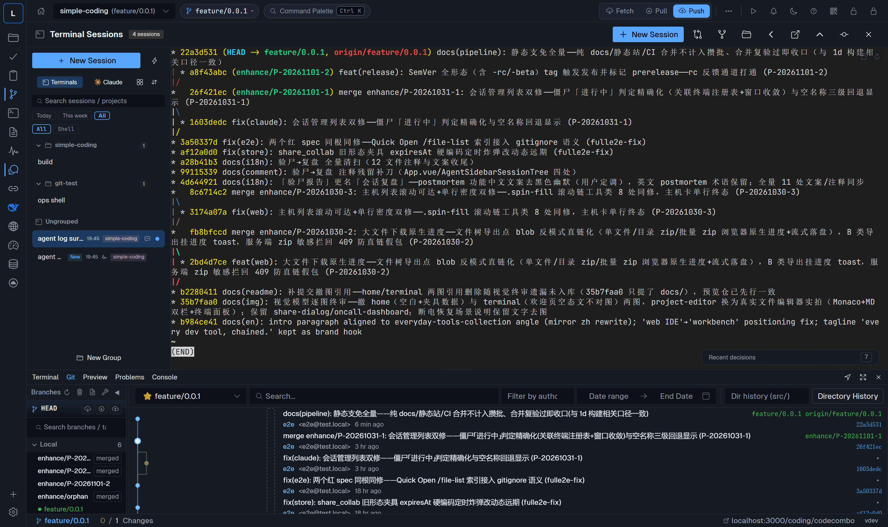
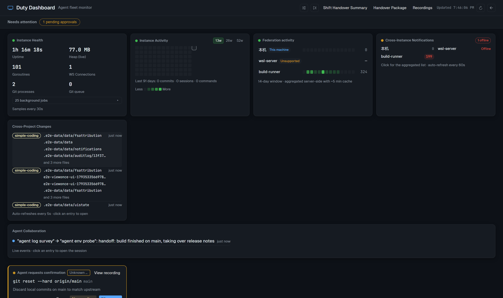
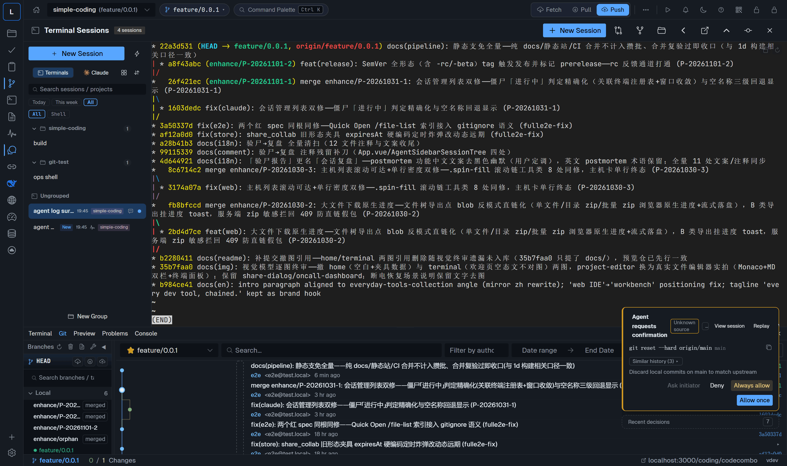
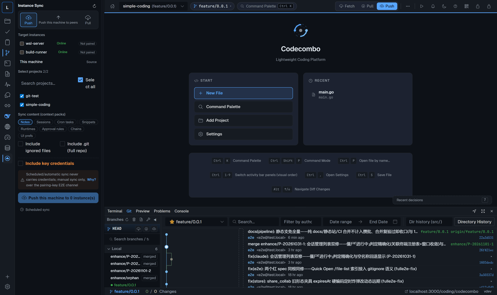
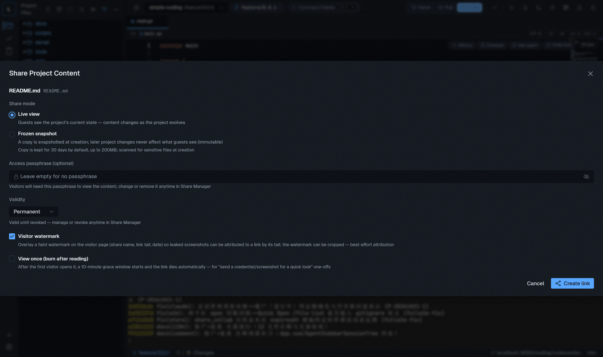
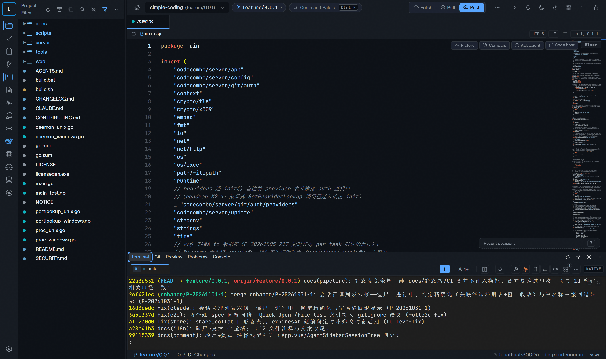

# Codecombo

**Language / 语言：English | [简体中文](docs/README.zh-CN.md)**


<!-- CI badge: uncomment after the first green run on GitHub Actions

-->

> **Status: Beta.** Codecombo is under active development and has not had its
> stable 1.0 release yet — interfaces and on-disk data formats may still change
> between versions. Feedback and bug reports are very welcome.

**Codecombo — one workbench for every dev tool.**

**Codecombo** is a self-hosted, single-binary workbench that collects your
everyday dev tools — a full Git workbench, real terminal sessions, AI coding
agents, remote machines — into one browser tab, where they share data and work
together. No more juggling separate apps.

- **One binary, no database** — Go (Gin) backend + Vue 3 (Naive UI) frontend
  embedded via `go:embed`; all state stays in `~/.codecombo/` on your machine.
- **Everything is a session** — local shells, remote SSH terminals, AI agents
  (claude / codex / dsh runtimes) live side by side in the same workspace.
- **Built for delegation with control** — agents can run autonomously, but
  high-risk actions come back to you as approval cards.

> **About dsh**: Codecombo neither includes nor distributes dsh (DeepSeek
> Harness) or any third-party agent runtime. It only ships an optional local
> embedding channel: if *you* installed dsh on your machine, Codecombo can
> embed its web UI over a loopback proxy. See [NOTICE](NOTICE).

## Quickstart

### One-line install (recommended)

Downloads the latest release binary, verifies SHA256, installs to
`~/.local/bin` (outside your data directory — the installer never touches
`~/.codecombo`, your data belongs to the app alone) and registers a service
(systemd on Linux, launchd on macOS, Windows service when elevated) — one
command you can paste to your AI assistant:

```bash
# Linux / macOS
p=$(mktemp) && curl -fsSL --retry 3 https://raw.githubusercontent.com/wtr20211202/codecombo/main/scripts/install.sh -o "$p" && sh "$p"; rm -f "$p"
```

```powershell
# Windows PowerShell
$p="$env:TEMP\codecombo-install-$([guid]::NewGuid()).ps1";[Net.ServicePointManager]::SecurityProtocol='Tls12';(New-Object Net.WebClient).DownloadFile('https://raw.githubusercontent.com/wtr20211202/codecombo/main/scripts/install.ps1',$p);powershell -NoProfile -ExecutionPolicy Bypass -File "$p";Remove-Item "$p" -ErrorAction SilentlyContinue
```

The script form downloads to a `mktemp` temp file first and verifies its own
integrity before installing (a trailing sentinel line detects truncated or
proxy-rewritten downloads; the temp name also avoids fixed-name collision and
symlink risks). `--retry 3` retries failed transfers on curl 7.12+ (macOS Big
Sur 7.64 / Ubuntu 20.04 7.68 / Debian 11 7.74 / RHEL 8 7.61 all qualify); with
curl ≥ 7.71 you can add `--retry-all-errors` yourself to also retry
mid-transfer interruptions — it is not in the default command because older
curl builds fail hard on unknown options. The Windows one-liner is the same
shape: it saves the script to a GUID-named temp file and runs it with
`powershell -NoProfile -ExecutionPolicy Bypass -File` (`Bypass` because script
files are blocked by the default execution policy; the explicit TLS 1.2 pin
keeps older .NET able to reach GitHub), then removes the file — the installer
refuses to run when the trailing sentinel is missing (truncated download) or
when it is executed from a string (`iex`) instead of a file.

**If `raw.githubusercontent.com` is unreachable** — on CN networks connections
to it are reset or drop mid-transfer routinely — the same install command
works through a community mirror prefix (`https://ghproxy.net/` in front of
the raw URL; same command shape, only the URL prefix changes):

```bash
# Linux / macOS — mirror fallback
p=$(mktemp) && curl -fsSL --retry 3 https://ghproxy.net/https://raw.githubusercontent.com/wtr20211202/codecombo/main/scripts/install.sh -o "$p" && sh "$p"; rm -f "$p"
```

**Trust boundary, stated plainly:** the trailing-sentinel self-check plus
SHA256 verification protects against truncated or corrupted transfers — not
against malicious rewriting by the mirror or anything on the path in between
(a rewritten script body that keeps the trailing sentinel passes the check;
when the `SHA256SUMS` manifest travels through the same mirror as the binary,
the verification baseline can be swapped along with them). If integrity
matters more than availability on your network, prefer the official direct
link or the npm channel (`npm i -g codecombo@next` — the npm registry has
integrity mechanisms built in). The Windows one-liner has no mirror variant
documented yet (planned follow-up).

Then open **https://localhost:9999** and set your lock password on first
start. TLS is on by default — a self-signed certificate is generated on first
start, so your browser will ask you to trust/continue on the first visit; if
certificate generation ever fails the service falls back to plain HTTP and
logs it. Version selection is automatic: the latest stable release when one
exists; until then the newest rc, falling back to the newest beta. Port, bind
address, install directory and data directory are adjustable — see
[Optional parameters](#optional-parameters); the ports the service opens by
default and what each is for — see [Default ports](#default-ports).

**Permissions & the service account.** To register the service you need
elevation — administrator PowerShell on Windows, sudo on Linux (the script
prompts for it and keeps the service running as *your* user, not root);
macOS launchd agents need no elevation. Without elevation the script still
installs the binary and prints a manual start command (no service
registration — `start` runs the app as a background daemon). The service
writes only to your own data directory (`~/.codecombo` — pinned via the
`--data-dir` service argument on Windows, since the service account's
default home points elsewhere).

**Change bind host / port after install**: re-run the same command with the
variables from [Optional parameters](#optional-parameters) (e.g.
`CODECOMBO_HOST=0.0.0.0` — mind where they go), or manage the service directly.
Service control differs per platform — `sc.exe` is Windows' built-in
Service Control command line (the counterpart of `systemctl` on Linux and
`launchctl` on macOS):

**Windows (service = `Codecombo`, via `sc.exe`)**

```powershell
sc.exe query Codecombo                # status
sc.exe stop Codecombo                 # stop
sc.exe config Codecombo binPath= "C:\Users\<you>\AppData\Local\Programs\codecombo\codecombo.exe --serve --port=9999 --host 0.0.0.0"
sc.exe start Codecombo                # start with new bind host
```

**Linux (systemd)**

```bash
sudo systemctl status codecombo       # status
sudo systemctl restart codecombo      # restart after editing the unit's --host
```

**macOS (launchd)**

```bash
launchctl list | grep codecombo       # status
# edit ~/Library/LaunchAgents/com.codecombo.plist (--host 0.0.0.0), then:
launchctl unload ~/Library/LaunchAgents/com.codecombo.plist
launchctl load ~/Library/LaunchAgents/com.codecombo.plist
```

#### Optional parameters

Both installers read four optional environment variables; leave them unset
and you get the defaults below — the same behavior as before:

| Variable | Default | Meaning |
|---|---|---|
| `CODECOMBO_PORT` | `9999` | Service port |
| `CODECOMBO_HOST` | `127.0.0.1` (this machine only) | Bind address; `0.0.0.0` = reachable from your LAN |
| `CODECOMBO_PREFIX` | `~/.local/bin` (Windows: `%LOCALAPPDATA%\Programs\codecombo`) | Directory the binary is installed to |
| `CODECOMBO_DATA_DIR` | `~/.codecombo` | Data directory (absolute path). Only handed to the service — `CC_DATA_DIR` in the systemd unit / launchd plist, `--data-dir` in the Windows service command line and in the printed manual start command; the installer still never creates or writes it |

Where they go: prefixed to the final `sh "$p"` segment of the one-liner
(placed before `curl` they only reach curl, and the script falls back to the
defaults); in PowerShell as `$env:` assignments before the one-liner — they stay set
for the rest of that PowerShell session and are inherited by the child process
the one-liner spawns.

```bash
# Second instance next to an existing one: own port, data dir and install dir
p=$(mktemp) && curl -fsSL --retry 3 https://raw.githubusercontent.com/wtr20211202/codecombo/main/scripts/install.sh -o "$p" && CODECOMBO_PORT=11000 CODECOMBO_DATA_DIR=$HOME/.codecombo-test CODECOMBO_PREFIX=$HOME/.local/codecombo-test sh "$p"; rm -f "$p"

# LAN access (all interfaces) — trusted networks only, the lock password is the only gate
p=$(mktemp) && curl -fsSL --retry 3 https://raw.githubusercontent.com/wtr20211202/codecombo/main/scripts/install.sh -o "$p" && CODECOMBO_HOST=0.0.0.0 sh "$p"; rm -f "$p"

# Custom install directory
p=$(mktemp) && curl -fsSL --retry 3 https://raw.githubusercontent.com/wtr20211202/codecombo/main/scripts/install.sh -o "$p" && CODECOMBO_PREFIX=$HOME/bin sh "$p"; rm -f "$p"
```

```powershell
# Windows: second instance next to an existing one
$env:CODECOMBO_PORT='11000'; $env:CODECOMBO_DATA_DIR="$HOME\.codecombo-test"; $env:CODECOMBO_PREFIX="$env:LOCALAPPDATA\Programs\codecombo-test"; $p="$env:TEMP\codecombo-install-$([guid]::NewGuid()).ps1";[Net.ServicePointManager]::SecurityProtocol='Tls12';(New-Object Net.WebClient).DownloadFile('https://raw.githubusercontent.com/wtr20211202/codecombo/main/scripts/install.ps1',$p);powershell -NoProfile -ExecutionPolicy Bypass -File "$p";Remove-Item "$p" -ErrorAction SilentlyContinue
```

Before adding a second instance:

- **One installer-managed service per machine.** Service names are fixed
  (`codecombo.service` / `com.codecombo` / `Codecombo`). If the existing
  instance already runs as that service (installed by this script or by
  remote deploy), a run with other settings re-points that service — it
  takes the existing instance over instead of adding one. Keep the second
  instance out of service registration then and start a binary with its own
  flags: `<bin> start --port 11000 --data-dir <dir>` — the command the
  installers print when they skip registration (non-elevated PowerShell,
  Linux without sudo credentials).
- **The CLI needs the data dir too**: `<bin> status --data-dir <dir>`,
  `<bin> stop --data-dir <dir>`.
- **Upgrades re-run with the same variables** — without
  `CODECOMBO_DATA_DIR` the rewritten service falls back to `~/.codecombo` at
  its next restart (your data stays in the custom dir; the instance just no
  longer reads it).
- **Never re-run the script on a remote-deployed instance** (see
  [Upgrading](#upgrading)).

#### Default ports

With defaults (main port `9999`) a running instance opens four ports. Each
auxiliary port tracks the main port (`+1` / `+2` / `+3`) unless configured
otherwise:

| Port (default) | What it is for |
|---|---|
| `9999` — main port | The one port you actually need: UI, API and terminals over **HTTPS/WSS**. TLS is on by default with a self-signed certificate (generated into the data directory's `certs/` on first start, reused after) — your browser asks you to trust/continue on the first visit. Turn TLS off with `--no-tls` or `CC_TLS=0` |
| `10000` — main+1 | Plaintext loopback helper, bound to `127.0.0.1` only: the local CLI (`status`/`stop`/`restart`) and agent callbacks keep plain-HTTP access despite the self-signed cert. Exists only while TLS is on. Move it with the `loopbackPort` config key |
| `10001` — main+2 | File-sharing sub-service — the `/s/…` links you share open on this port (bound to the same address as the main port). Move it with the `sharePort` config key |
| `10002` — main+3 | Plaintext companion on the main bind address (LAN-reachable): an out-of-the-box http face for deep-inspection networks where TLS is slow. Credentials travel unencrypted here — turn it off with `"httpPort": 0` in `config.json` |

Certificate trust (installing `certs/cert.pem` into a client trust store),
instance-to-instance TLS, and the companion-port trade-offs are covered in
[deploy-linux.md §4.1](docs/deploy-linux.md) and [§8](docs/deploy-linux.md).

**Changing the service shape to plain HTTP** (rarely needed — the installers
register the service without TLS switches, so it runs with the TLS-on
default): one edit per platform, then restart:

```bash
# systemd: drop an override with Environment=CC_TLS=0 under [Service]
sudo systemctl edit codecombo        # add:  [Service]  /  Environment=CC_TLS=0
sudo systemctl restart codecombo
```

```bash
# launchd: add <string>--no-tls</string> to ProgramArguments in
# ~/Library/LaunchAgents/com.codecombo.plist, then
launchctl unload ~/Library/LaunchAgents/com.codecombo.plist
launchctl load ~/Library/LaunchAgents/com.codecombo.plist
```

```powershell
# Windows service: read the current command line, re-set it with --no-tls
# appended (keep --data-dir and the rest as they are), then
sc.exe qc Codecombo
sc.exe config Codecombo binPath= "<current command line> --no-tls"
sc.exe start Codecombo
```

### Install with npm

```bash
npm i -g codecombo
codecombo start
```

Then open **https://localhost:9999** and set your lock password on first
start (TLS is on by default — self-signed certificate, accept the browser
warning on first visit; see [Default ports](#default-ports)).
Requires Node.js 18+ — the npm package is a thin wrapper; `npm` picks the
native binary for your platform (Windows / Linux / macOS, amd64 & arm64) via
optional dependencies. No postinstall scripts. Prebuilt binaries are also on
the [Releases](../../releases) page.

Until 1.0, `npm i -g codecombo` is always the newest build — every release
(including rc / beta previews) moves `latest` too. Explicit pins work, e.g.
`npm i -g codecombo@0.2.0-rc1`, and `@next` always tracks the newest
pre-release. From 1.0 on, the stable and preview channels split: `latest`
moves only with stable releases, and pre-release versions (rc / beta)
publish to the `next` channel. Updates for npm installs are owned by npm: the
in-app updater stays off for this install shape — just re-run the install
command to move to the latest.

Restarts triggered from the settings page are supervised in both npm shapes:
a foreground `codecombo --serve` stays attached to your terminal (the wrapper
re-spawns the binary), and a `codecombo start` daemon re-spawns itself
detached — closing the terminal afterwards does not kill it (follow-up output
lands in `~/.codecombo/logs/update-restart.log`). A restart crash loop
(5 requests within 60s) trips the wrapper's breaker instead of spinning.

### Upgrading

**Install method decides update method.** Identify your install first — run
`systemctl cat codecombo` and read the binary path in `ExecStart` (no unit,
e.g. a manually started instance — `start` daemon or `--serve` foreground —
or a remote deploy in "direct process" mode: `ps -ef | grep codecombo`
shows the running binary path; `~` is the service user's home, shown as an
absolute path in the unit):

| Check | Installed by | How to upgrade |
|---|---|---|
| `ExecStart` → `~/.local/bin/codecombo` | the install script above | 1 in-app update (preferred) · 2 re-run the script |
| `sc.exe query Codecombo` lists the service | Windows install script (install.ps1, elevated) | 1 in-app update (preferred) · 2 re-run install.ps1 — the installer stops the running service itself |
| `ExecStart` → `~/.codecombo/bin/codecombo` | remote deploy from a central instance | 1 in-app update · re-deploy remotely · 3 manual replacement — **never** re-run the script |
| `ExecStart` → `/opt/codecombo/bin/codecombo` | manual `/opt` layout ([deploy-linux](docs/deploy-linux.md)) | 1 in-app update · 3 manual replacement |
| `npm ls -g codecombo` lists it | npm | `npm i -g codecombo@latest` (the in-app updater steps aside) |

**1. In-app update (recommended shape)** — "Check Update" in the version
panel (Settings → About) pulls the new binary from GitHub and swaps it with
automatic rollback on failure. Three notes: versions older than
v0.0.1-beta.3 cannot see new releases in-app (a check-chain defect, fixed
in v0.0.1-beta.3) — upgrade once via the script/manual paths below first;
during the beta phase the GitHub stable channel stays empty, so turn on
**Follow pre-releases** in the version panel before checking; and on macOS,
a binary that was ever replaced by hand with a browser-downloaded release
artifact carries the `com.apple.quarantine` attribute — background spawn
may then be silently refused, the in-app update's swap subprocess never
starts and the rollout dies without a visible error (the app just never
comes back on the new version). For manual replacement on macOS, don't use
browser-downloaded artifacts — download with `curl` or clear the attribute
with `xattr -d com.apple.quarantine <binary>`; an instance already stuck
there upgrades once via the paths below — re-running the install script is
safe for script installs, while remote-deploy instances must get a fresh
remote deploy from the central instance instead (**never** re-run the
script — see the table above and the warning under 2). If the quarantine
attribute was already cleared and the symptom is unchanged, this is not the
cause — see the launchd process-group case next.

**macOS launchd installs on v0.0.1-beta.9 or older: in-app update never
completes.** launchd cleans up the job's whole process group when the main
process exits (best-effort, with no timing guarantee), so the update's swap
subprocess is killed before it can even open its log: the app silently
reverts to the old version — no error, no result file, and
`<data-dir>/logs/update.log` is never created. **From v0.0.1-beta.10 on,
in-app update works** (the swap subprocess starts in its own process
group). The plist side of the fix is independent of the binary version:
re-running the install script writes `AbandonProcessGroup=true` into the
plist and loads it, which takes effect immediately — a script-installed
instance on ≤beta.9 upgrades in-app right after the re-run;
remote-deployed instances get the same key from a fresh remote deploy
(the central instance must run beta.10+); a hand-written plist can simply
add the key itself; otherwise install beta.10+ by hand. To tell the three
macOS silent-failure shapes apart:
- the service log (`<data-dir>/logs/codecombo-<date>.log`) has
  `start update process failed` → the subprocess cannot start
  (quarantine/permissions);
- no such line, `<data-dir>/logs/update.log` does not exist, and
  `<data-dir>/tmp/update-*` holds a complete downloaded artifact →
  launchd process-group kill (this case);
- `update.log` contains `waiting for old process` → the liveness/wait
  chain stalled.

Self-built systemd units must keep `KillMode=process`: under the systemd
default (`control-group`) the swap subprocess is cleaned up the same way
when the main process exits — the same silent failure.

Script-installed (systemd-managed) instances: if the service has not come
back on its own after updating, `sudo systemctl restart codecombo` finishes
the rollout.

**Restart behavior** (in-app updates and the settings-page restart share the
same chain): systemd / Windows-service / launchd instances are re-launched by
their supervisor. A manually started instance restarts as a detached daemon —
a foreground `codecombo --serve` returns to the prompt and follow-up output
lands in `~/.codecombo/logs/update-restart.log` (npm installs keep their own
supervision: the wrapper re-spawns a foreground `--serve` attached to your
terminal).

**2. Re-run the install script (script installs only)** — re-running is
upgrade-safe: the script replaces the binary and the service registration
only and never touches the data directory (all data, configuration and
keys — the lock password included — live there and survive the re-run
as-is). Read your original `--host`/`--port` from `ExecStart` (installed
with a custom data dir? also pass its `CC_DATA_DIR` from the unit's
`Environment=` line back as `CODECOMBO_DATA_DIR` — re-run with the same
value); the env vars must prefix the final `sh "$p"` segment of the one-liner
(placed before `curl` they only apply to curl, and the port/bind fall back
to the 9999/127.0.0.1 defaults):

```bash
sudo -v && p=$(mktemp) && curl -fsSL --retry 3 https://raw.githubusercontent.com/wtr20211202/codecombo/main/scripts/install.sh -o "$p" && CODECOMBO_HOST=<original> CODECOMBO_PORT=<original> sh "$p"; rm -f "$p"
```

`sudo -v` first — the script probes elevation with `sudo -n`
(non-interactive) and auto-registers the service only when credentials are
cached (passwordless sudo also passes); without them it still swaps the
binary but skips the service unit. The script swaps the binary via rename
(a running service is fine) but keeps serving the old version until restart:
when it reports a running instance, close with
`sudo systemctl restart codecombo`. On macOS re-running takes effect
immediately (the script reloads the launchd agent itself). **Instances
installed by remote deploy must not re-run the script** — the templated unit
overwrite drops `PATH`/`WorkingDirectory`/`NoNewPrivileges` and reverts the
bind address to `127.0.0.1`, cutting remote access as soon as the service
restarts; that layout upgrades in-app or via a fresh remote deploy from the
central instance (use a central instance on v0.0.1-beta.3 or later — earlier
deployers could fail to upgrade older installs in place). On Windows,
re-run install.ps1 from an elevated PowerShell with the same
`$env:CODECOMBO_*` values as the original install (the current
`--port`/`--host`/`--data-dir` are in the `BINARY_PATH_NAME` line of
`sc.exe qc Codecombo`) — the installer stops the running `Codecombo`
service itself before the swap (Windows locks a running `.exe`, so the
swap cannot succeed with the service up; a non-elevated re-run against the
running service fails fast with that hint).

**3. Manual binary replacement (Linux only)** — the full recipe (stop →
verify SHA256 → keep a `.bak` → replace → start, plus the rollback step)
lives in [docs/deploy-linux.md](docs/deploy-linux.md) §6; the three-state
`status=203/EXEC` triage for a service that won't start is in §7 of the same
doc. Mind the file size: binaries are ~50 MB (linux-amd64 ≈ 51–54 MB) — a
file of tens of bytes means you clicked a `.sha256`/`.sig` sidecar instead
of the binary.

### Update proxy

The update chain (release checks and binary downloads) picks its outbound
route per request in one fixed priority order — **explicit setting >
environment variables > system auto-detect (while the switch is on) >
direct**:

1. **Explicit setting** — `updateProxy`, the "Update Proxy" field in the
   version panel (Settings → About). Accepts `http://` / `https://`
   (CONNECT tunnel) and `socks5://` (`socks5h` is a synonym) — corporate
   proxies and local clash client ports (`127.0.0.1:…`) are the intended
   scenarios. An explicit proxy covers the whole update chain; `NO_PROXY`
   is not consulted for it.
2. **Environment variables** — the standard `HTTPS_PROXY` / `HTTP_PROXY` /
   `NO_PROXY` semantics (lowercase variants included). On servers, put
   them on the systemd unit's `Environment=` line and restart the service
   ([docs/deploy-linux.md](docs/deploy-linux.md) §3 has the example).
3. **System proxy auto-detect** — the "Auto-detect system proxy" switch
   (`updateProxyAutoDetect`, off by default). When neither tier above
   provides a proxy, the update chain uses the desktop system proxy
   detected on the machine: Windows Internet settings, macOS network
   settings (scutil), Linux GNOME (gsettings) — static proxy settings
   only, PAC/WPAD auto-config scripts are not evaluated. The detected
   proxy honors `NO_PROXY` (matching targets go direct). Detection runs
   only at startup, settings saves and update attempts — never per
   connection — so keeping the switch on adds no per-request latency.
4. **Direct** — nothing above applied; direct connections keep the
   dial-time private/reserved-IP guard.

Both proxy settings are bound to the machine's network topology: they are
excluded from settings sync/migration, so set them per instance.

Troubleshooting "which route is the update actually taking": the version
panel shows the **Effective route** tier next to the proxy settings, and
`GET /api/updates/proxy-status` returns the machine-readable snapshot —
`tier` (`explicit` / `env` / `sysdetect` / `direct`), the effective proxy
address (credentials redacted), the switch state and the last detection
result; `?refresh=1` re-detects immediately (still zero detection while
the switch is off). Call it in a browser unlocked on this instance, or
with an `Authorization: Bearer sc_…` access-token header.

One security note: under any proxy tier the update target is resolved by
the proxy, so the dial-time IP guard is replaced by an official-domain
allowlist (GitHub's official update domains ∪ your explicitly configured
update source host), checked on every hop including redirects.

### Build and run

Prerequisites: Go 1.26+, Node.js 20.19+ / 22.12+, Git.

```bash
git clone https://github.com/wtr20211202/codecombo.git
cd codecombo

./build.sh            # Linux/macOS — frontend + Go, output to dist/
build.bat             # Windows

./dist/codecombo start        # start the service (daemon)
# or: ./dist/codecombo        # equivalent to `start`
```

Then open **https://localhost:9999**, set your lock password on first start
(TLS is on by default — self-signed certificate, accept the browser warning
on first visit), and add a project (a local Git repo, or clone one). Prebuilt binaries for
Windows / Linux / macOS (amd64 & arm64) are published on the
[Releases](../../releases) page.

### Development mode

```bash
cd web && npm install && npm run dev   # Vite dev server on :5173 (proxies to :9999)
go run main.go                         # Go backend on :9999 (second terminal)
```

Run the quality gates before submitting changes: `cd web && npm run check`
(type-check + lint + unit tests + contract gates) and `go test ./...`.

### Access from other devices (LAN)

By default Codecombo binds to `127.0.0.1` (this machine only). To reach it
from your phone or another machine on the LAN, bind all interfaces:

```bash
codecombo start --host 0.0.0.0        # or: -H 0.0.0.0 (flag beats config.json server.host)
```

Then open `https://<machine-ip>:9999` from the other device (TLS is on by
default — accept the self-signed certificate warning on first visit; a
plaintext companion port exists for deep-inspection networks that slow TLS
down, see [Default ports](#default-ports)). The lock password
(first-start setup) is the gate — bind to `0.0.0.0` only on networks you trust.

## First steps

The sections above install the app; this one gets you working. A ten-minute
loop from a fresh instance to real work — every step below is an existing
capability, covered in depth in [What's inside](#whats-inside) and
[Highlights](#highlights).

**1. Open the workbench, set the lock.** Open **https://localhost:9999** and
set your lock password on first start (TLS is on by default — self-signed
certificate, accept the browser warning on first visit) — it is the gate for
every visit, with idle auto-lock on top.

**2. Add a project — or hand even that to an agent.** Add a local Git repo
(or clone one) from the home screen. Or skip the step entirely — the
shortcut this workbench is built for: open an **agent session** first (it
needs no project — any directory will do, your home directory by default)
and ask it in the chat to add your projects. Agents operate the workbench
itself over the ops channel: adding a project (`POST /api/projects`) is in
their rendered handbook (`GET /api/ops-manual`), and their session ships the
`CC_LOCK_TOKEN` credential out of the box. Two ground rules apply: a project
path must be a Git repository (the agent can `git init` or clone one first),
and high-risk actions still come back to you as approval cards.

**3. Give the agent its first task.** Type it into the session: run the
tests, fix this bug, build that feature. Sessions auto-name themselves after
their first task, and every session is a real PTY — refresh the page and
replay the full scrollback, bookmark lines, search all output.

**4. Judge the risky bits.** Agents don't get a blank check: when a high-risk
command or a mass file replacement comes up, it returns as an approval card
with a live terminal recording — watch what the agent did, then approve,
deny, or edit per item.

**5. Two things to try while it works.** Right-click any file → **Share**:
a one-click link (TTL, password, view-once) that visitors open without an
account. And open **Notes** — the notepad you share with your agents: ask
the agent to deposit a handoff note there, and the next session picks up
where this one left off.

From here the [table below](#whats-inside) maps the rest of the toolbox;
[Highlights](#highlights) goes one level deeper per tool.

## What's inside

| Tool | What it does |
|---|---|
| **Git workbench** | Visual Git: hunk-level staging, three-way diffs, drag-and-drop interactive rebase, merge preview, conflict resolution, worktrees, submodules, LFS, GPG-signed commits, commit graph with cherry-pick / squash / extract |
| **Web terminal** | Real PTYs (ConPTY / pty), optional tmux persistence with output replay across restarts, split panes, floating windows, image paste upload, bookmarks, command blocks |
| **Remote machines** | SSH host management with encrypted credentials, remote terminals (incl. remote tmux), one-click remote deployment pipelines (bootstrap → runtime → systemd), live deploy logs, port forwarding |
| **AI agent sessions** | claude / codex / dsh sessions per project — side-by-side runs, continuation chains, scheduled jobs, reusable runbooks, fleet execution; sessions auto-named after their first task, organized into custom groups, restored as they were after power loss or reboot; every session a real PTY with replayable scrollback |
| **Agent ops channel** | Agents operate the workbench itself over a structured API: downloads, clipboard, open-at-line, preview links, ask & approval cards, cross-device notifications |
| **Approval center** | High-risk commands and mass replacements return as approval cards with live terminal recording — approve / deny / edit per item; secrets redacted on the way out |
| **Notes** | A human & agent shared notepad — one project-independent notes library; agents read and write the same library over the ops API, depositing handoff notes so the next session picks up where the last one left off |
| **TODO list** | Code-comment TODO / FIXME / XXX / HACK markers aggregated into one board — the "IOU list" humans leave for the next round of agent work |
| **Change stream** | Cross-project live timeline of file changes — the in-workbench entry to "what just changed anywhere", beyond the on-call dashboard card |
| **Environment profile** | A read-only "environment résumé" per project: dev ports observed in terminals or reported by agents, visible output-sentinel rules, deploy target hosts — a newcomer (human or agent) stops guessing ports from terminal history |
| **On-call dashboard** | One screen for instance health (memory / goroutines / git pressure), 52-week activity heatmap, live change stream, agent collaboration flow, stalled-session triage |
| **Multi-instance sync** | Manage local & remote instances from one screen: switching with health overview, terminal/panel take-over, instance-to-instance sync, encrypted machine migration (`.scpkg`) |
| **Sharing links** | One-click links for files / folders / snippets / live terminals — TTL, password, view-once, frozen snapshot; visitors need no account |
| **dsh integration** | Embed the dsh (DeepSeek Harness) Web UI over a loopback proxy, plus npm version management: upgrade / rollback with changelog |
| **Security foundation** | Global lock (first-start password, idle auto-lock), AES-256 master-key encryption for all stored secrets, per-IP rate limiting, audit log with CSV export |
| **Self-update** | GitHub-release-based update checks with automatic rollback; central instances can cache and forward binaries to child instances |
| **i18n & themes** | English / 简体中文 UI; four built-in themes (Dark / Light / One Dark / Dracula) |

Details and screenshots per tool in [Highlights](#highlights).

## Highlights

Each module below keeps a short summary + screenshot; the full walkthroughs
and the module-by-module guide live in the official docs —
[Getting started](https://wtr20211202.github.io/codecombo/guide/getting-started.html) ·
[Features](https://wtr20211202.github.io/codecombo/guide/features.html) ·
[FAQ](https://wtr20211202.github.io/codecombo/guide/faq.html) (in-repo sources: [site/guide/](site/guide/)).

### Agent ops channel

The part no other terminal has: agents do not just run *inside* Codecombo —
they can operate the workbench itself over a structured API, and structured
questions (ask cards) or high-risk action requests (approval cards) come back
to you. Capabilities are registered in a single registry with a rendered
handbook (`GET /api/ops-manual`) agents can read; downloads, clipboard,
open-at-line, preview links and cross-device notifications ride the same
channel.

Details → [official docs](https://wtr20211202.github.io/codecombo/guide/features.html#agent-sessions) · [in-repo source](site/guide/features.html#agent-sessions)

### AI agent sessions

Run multiple AI agent sessions per project — side-by-side comparison of two
agents on the same task, session continuation chains, scheduled agent jobs,
reusable runbooks, and fleet execution. Every session is a real PTY: refresh
the page and replay the full scrollback.



Details → [official docs](https://wtr20211202.github.io/codecombo/guide/features.html#agent-sessions) · [in-repo source](site/guide/features.html#agent-sessions)

### On-call dashboard

A single screen for "what is my box doing right now": instance health (memory /
goroutines / WebSocket clients / git process pressure), a 52-week activity
heatmap, a cross-project live change stream, agent collaboration flow,
stalled-session triage, and approval cards waiting for judgement.



Details → [official docs](https://wtr20211202.github.io/codecombo/guide/features.html#oncall) · [in-repo source](site/guide/features.html#oncall)

### Approval center

Agents don't get a blank check. High-risk commands and mass file replacements
return as approval cards with live terminal recording — watch what the agent
did, then approve, deny, or edit per item. Sensitive values (tokens, passwords,
cloud keys) are redacted on the way out.



Details → [official docs](https://wtr20211202.github.io/codecombo/guide/features.html#approvals) · [in-repo source](site/guide/features.html#approvals)

### Multi-instance sync

One Codecombo instance can manage many others — local or remote — through a
central proxy: instance switching with health overview, terminal and panel
take-over of a remote instance, instance-to-instance sync, and one-shot
machine migration (export/import an encrypted `.scpkg` package with
credentials, settings and project contexts).



Details → [official docs](https://wtr20211202.github.io/codecombo/guide/features.html#sync) · [in-repo source](site/guide/features.html#sync)

### Sharing links

Share a file, a folder, a text snippet, or a live terminal with visitors via
one-click links — TTL, password, view-once and frozen-snapshot are all one
toggle away; visitors need no account.

Live terminal shares are read-only by default and masked; the owner can
optionally open **guest input** (open mode, or request-and-approve). In that
writable mode the page carries a persistent **Upload files/images** button —
it works in every browser and on mobile: images are compressed, the same type
and size limits apply, and the saved path is typed into the terminal. With the
terminal focused, **Ctrl+V** now reaches the browser's native paste: files are
uploaded as above, and plain text is pasted through the terminal input channel
(the same command-approval and audit path as typing). The trade-off is that
Ctrl+V is no longer forwarded to the host as a literal `^V`, so terminal
programs that bind it (for example Vim's visual block) no longer receive it.
Pasting files with Ctrl+V still depends on the browser: Firefox does not expose
files copied from the file manager via `clipboardData.files`, pasting files is
not available in iOS Safari, desktop Safari greys it out, and Android Chrome
depends on clipboard permissions — when the clipboard really holds an image
the page also tries an explicit clipboard read as a fallback. On mobile or
any other browser you can additionally use the collaboration-material entry
(camera / choose files) when the owner has enabled collaboration; dragging
files onto a writable page uploads nothing — the page blocks the default
navigation and points you to the upload button or Ctrl+V.



Details → [official docs](https://wtr20211202.github.io/codecombo/guide/features.html#sharing) · [in-repo source](site/guide/features.html#sharing)

### …and a complete Git workbench

Staging down to the hunk level, three-way diffs, interactive rebase with
drag-and-drop, merge preview, changelists and shelves, conflict resolution,
worktrees, submodules, LFS, GPG-signed commits, reflog, patch export/import,
and a commit graph you can cherry-pick / squash / extract from.



Details → [official docs](https://wtr20211202.github.io/codecombo/guide/features.html#git-workbench) · [in-repo source](site/guide/features.html#git-workbench)

## Highlights (continued): the rest of the toolbox

- **dsh integration** — the dsh (DeepSeek Harness) Web UI embedded over a
  loopback proxy; npm version management with upgrade / rollback and a version
  changelog.
- **Web terminal** — real PTYs (ConPTY on Windows, creack/pty on Unix),
  optional tmux persistence with output replay across restarts, split panes,
  floating windows, image paste upload, bookmarks, command blocks.
- **Remote machines** — SSH host management with encrypted credentials,
  remote terminals (with remote tmux), one-click remote deployment pipelines,
  live deploy logs, port forwarding.
- **Security foundation** — global lock (first-start password setup, idle
  auto-lock), AES-256 encryption for all stored secrets via a local master
  key, per-IP rate limiting, audit log with CSV export.
- **Self-update** — GitHub-release-based update checks with automatic
  rollback; central instances can cache and forward binaries to child
  instances. Zero-config: the official repo is the built-in default source.
  Automatic checks run every 24h and notify on new versions — toggle in the
  version panel to opt out. Which upgrade path applies depends on how you
  installed — see [Upgrading](#upgrading); module guide entry in the docs
  Features page: [official docs](https://wtr20211202.github.io/codecombo/guide/features.html#more) ·
  [in-repo source](site/guide/features.html#more).
- **i18n & themes** — English / 简体中文 UI; four built-in themes
  (Dark / Light / One Dark / Dracula).

## Project structure

```
codecombo/
├── main.go                  # CLI entry (start/stop/update/reset-lock/credential-helper), daemon, embed
├── server/
│   ├── api/                 # HTTP/WS API layer (admin / gitops / notify / shared)
│   ├── git/                 # Git CLI wrapper (execGit + auth injection + write queue)
│   ├── terminal/            # PTY session management (native / tmux backends)
│   ├── deploy/              # Remote deploy engine (Deployer registry + task manager)
│   ├── sync/                # Multi-instance sync + machine migration (.scpkg)
│   ├── share/               # Visitor share links (file/snippet/terminal)
│   ├── config/              # Config store, master-key crypto, data-dir migration
│   ├── store/               # JSON persistence (per-domain stores)
│   └── ...                  # metrics / notification / proxy / update / watch / recording
├── web/                     # Vue 3 + TypeScript frontend (embedded via go:embed)
│   ├── src/views/           # Panels: git, terminal, editor, agents, monitor, settings
│   ├── src/components/      # UI components (layout / monitor / recording / ...)
│   └── e2e/                 # Playwright end-to-end tests
├── docs/                    # Architecture & design docs (Chinese, EN translation on roadmap)
├── scripts/                 # Dev/test tooling (e2e harness, gates)
└── build.sh / build.bat     # Cross-platform build (6 targets)
```

## Docs

Two entry points, by audience:

**User documentation — official site** (English & 简体中文), the same pages the
Highlights above link into:

- [Getting started](https://wtr20211202.github.io/codecombo/guide/getting-started.html) — install → set the lock → add a project (or let an agent do it) → restart recovery → share & notes · in-repo source: [site/guide/getting-started.html](site/guide/getting-started.html)
- [Features](https://wtr20211202.github.io/codecombo/guide/features.html) — every module of the workbench in one guide: what each one is for and where to find it · in-repo source: [site/guide/features.html](site/guide/features.html)
- [FAQ](https://wtr20211202.github.io/codecombo/guide/faq.html) — ports & access, data & backups, which upgrade path is yours, lock & remote access, common errors (203/EXEC …) · in-repo source: [site/guide/faq.html](site/guide/faq.html)

**Architecture & design documents — for contributors**, live in
[`docs/`](docs) — currently in Chinese, English translation is on the roadmap:

- [docs/AGENT_SESSIONS.md](docs/AGENT_SESSIONS.md) — agent sessions, approvals, orchestration primitives, and how the ops manual is injected per runtime (claude / codex auto-inject, dsh manual)
- [docs/EXTENSION_POINTS.md](docs/EXTENSION_POINTS.md) — index of all extension points (kernel modules, deployers, platform adapters, frontend panels, ops events)
- [docs/PERSISTENCE_LANES.md](docs/PERSISTENCE_LANES.md) — the three persistence lanes
- [docs/OPS_EVENTS.md](docs/OPS_EVENTS.md) — ops-channel event catalog for agents
- [docs/adr/](docs/adr) — architecture decision records
- [docs/deploy-linux.md](docs/deploy-linux.md) — Linux deployment guide
- [docs/remote-access.md](docs/remote-access.md) — LAN/remote access & security notes

## Roadmap

- [ ] English translation of the docs (progressive, by demand)
- [ ] SQLite as an optional storage backend — under consideration based on user
      feedback; deliberately **not** implemented before open-sourcing
- [ ] macOS CI in addition to Windows + Linux
- [ ] Plugin API on top of the existing extension points

## Contributing

**Pull requests are welcome** — bug fixes, docs and features alike. Please
open an issue first for non-trivial changes, sign your commits (DCO,
`git commit -s`), and make sure the test gates pass. See
[CONTRIBUTING.md](CONTRIBUTING.md) for the full guide and the development
environment setup. Please keep the discussion area friendly and on-topic.

## Security

Please report vulnerabilities privately via
[GitHub Security Advisories](../../security/advisories/new) — do not open
public issues for security problems. See [SECURITY.md](SECURITY.md).

## License

[Apache License 2.0](LICENSE). The bundled fonts and vendored assets are
covered by their own licenses, catalogued in [NOTICE](NOTICE).
