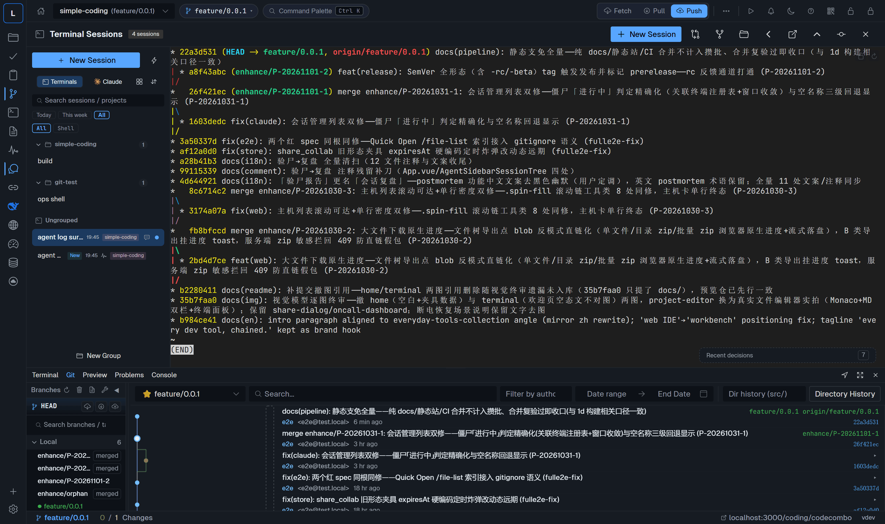
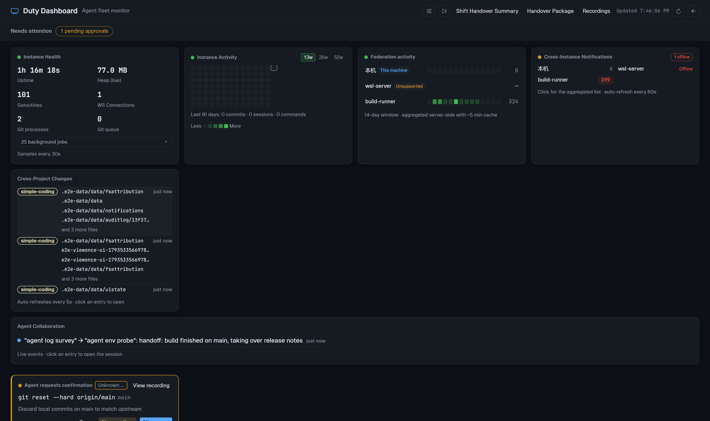
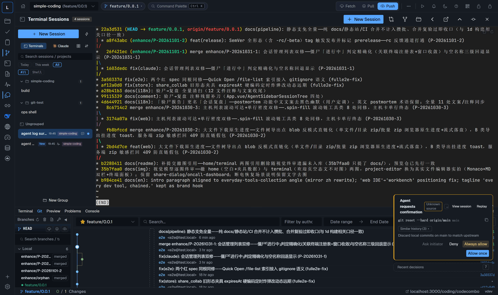
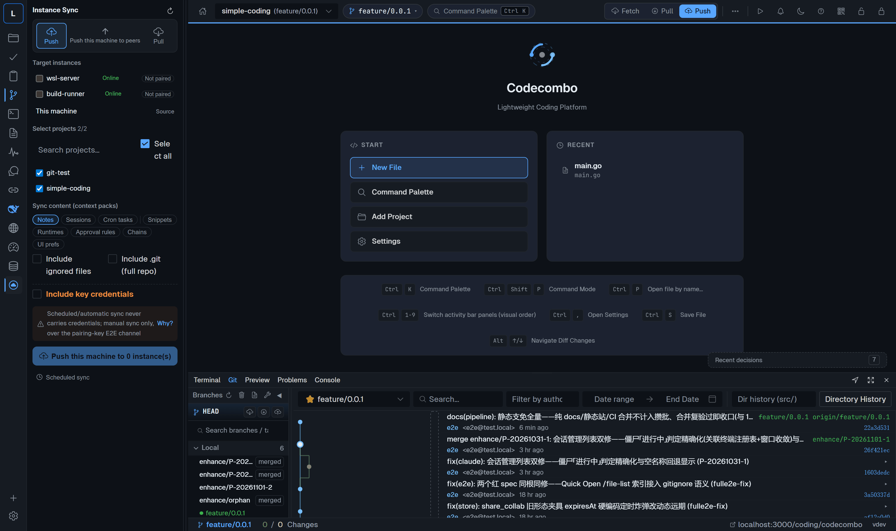
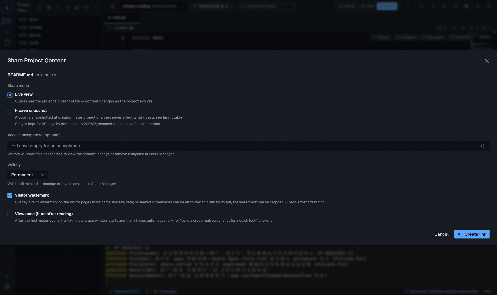
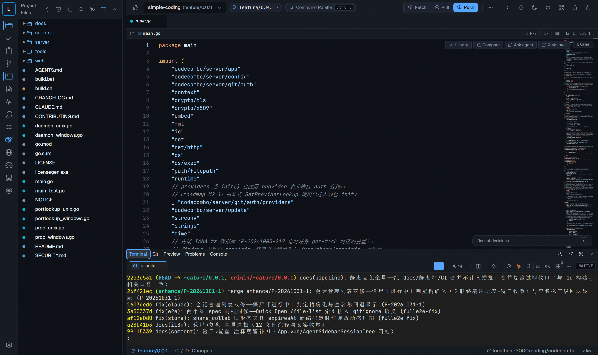

# Codecombo（简体中文）

**Language / 语言：[English](../README.md) | 简体中文**


> **状态：Beta（预览版）。** Codecombo 仍在积极开发中，尚未正式发布 1.0——
> 界面与磁盘数据格式在版本间仍可能调整。欢迎提 issue 反馈问题与建议。

**Codecombo —— 开发常用工具的一站式集合。** 自托管的单二进制 Web 工作台：
Git 工作台、真实终端会话、AI 智能体、远程主机管理，全部装进同一个浏览器
标签页——工具之间数据互通、彼此协作，不用在多个软件之间来回切换。

- **一个二进制，零外部数据库** —— Go (Gin) 后端 + Vue 3 (Naive UI) 前端经
  `go:embed` 嵌入；全部状态落在本机 `~/.codecombo/`。
- **万物皆会话** —— 本地 shell、远程 SSH 终端、AI 智能体（claude / codex /
  dsh 运行时）在同一工作区并肩工作。
- **授权委托但有刹车** —— 智能体可自主连续工作，高危动作以审批卡回到人的手上。

> **关于 dsh**：Codecombo 不包含亦不分发 dsh（DeepSeek Harness）或任何第三方
> 智能体运行时，仅提供可选的本机嵌入通道——用户自行安装 dsh 后，Codecombo
> 可经回环反代把其 Web UI 嵌入面板。详见 [NOTICE](../NOTICE)。

## 快速开始

### 一键安装（推荐）

下载最新正式版二进制 → SHA256 校验 → 装入 `~/.local/bin`（数据目录之外——
安装器绝不触碰 `~/.codecombo`，数据只归应用自己管理）并注册服务
（Linux systemd / macOS launchd / Windows 管理员时注册系统服务）——整条
命令可以直接丢给你的 AI 助手代跑：

```bash
# Linux / macOS
curl -fsSL https://raw.githubusercontent.com/wtr20211202/codecombo/main/scripts/install.sh | sh
```

```powershell
# Windows PowerShell
iex ((New-Object System.Net.WebClient).DownloadString('https://raw.githubusercontent.com/wtr20211202/codecombo/main/scripts/install.ps1'))
```

浏览器打开 **http://localhost:9999**，首启设置锁密码。版本全自动决策：
有正式版装最新正式版；当前没有正式版时装最新 rc，没有 rc 才装最新 beta。
端口、绑定地址、安装目录与数据目录均可指定——见下方[可选参数](#可选参数)。

**权限与服务运行账户。** 注册服务需要提权——Windows 用管理员 PowerShell，
Linux 用 sudo（脚本内部提权写系统文件，服务仍以**当前用户**身份运行而非
root）；macOS launchd 用户代理无需提权。不提权也能装：脚本会装好二进制并
打印手动启动命令（不注册系统服务——`start` 即后台守护运行）。服务只写你自己的数据目录（`~/.codecombo`——Windows 下经服务命令行
`--data-dir` 旗标钉死到安装者用户目录）。

**安装后改绑定/端口**：按[可选参数](#可选参数)的写法带环境变量重跑同一命令（如
`CODECOMBO_HOST=0.0.0.0`，Windows 为 `$env:CODECOMBO_HOST='0.0.0.0'`，幂等更新服务配置），
或直接管理服务。服务管理命令**各平台不同**——Windows 的
`sc.exe` 是系统自带的服务控制命令行（对应 Linux 的 `systemctl`、macOS 的
`launchctl`）：

**Windows（服务名 `Codecombo`，用 `sc.exe`）**

```powershell
sc.exe query Codecombo                # 查看状态
sc.exe stop Codecombo                 # 停止
sc.exe config Codecombo binPath= "C:\Users\<你>\AppData\Local\Programs\codecombo\codecombo.exe --serve --port=9999 --host 0.0.0.0"
sc.exe start Codecombo                # 以新绑定地址启动
```

**Linux（systemd）**

```bash
sudo systemctl status codecombo       # 查看状态
# 改 unit 内 --host 后：
sudo systemctl restart codecombo
```

**macOS（launchd）**

```bash
launchctl list | grep codecombo       # 查看状态
# 编辑 ~/Library/LaunchAgents/com.codecombo.plist 的 --host 后：
launchctl unload ~/Library/LaunchAgents/com.codecombo.plist
launchctl load ~/Library/LaunchAgents/com.codecombo.plist
```

#### 可选参数

两个安装脚本都读四个可选环境变量；不设置即取下表默认值——与此前行为完全一致：

| 变量 | 默认值 | 含义 |
|---|---|---|
| `CODECOMBO_PORT` | `9999` | 服务端口 |
| `CODECOMBO_HOST` | `127.0.0.1`（仅本机） | 绑定地址；`0.0.0.0` = 局域网可达 |
| `CODECOMBO_PREFIX` | `~/.local/bin`（Windows：`%LOCALAPPDATA%\Programs\codecombo`） | 二进制安装目录 |
| `CODECOMBO_DATA_DIR` | `~/.codecombo` | 数据目录（绝对路径）。只把路径交给服务——systemd unit / launchd plist 的 `CC_DATA_DIR`、Windows 服务命令行与打印的手动启动命令里的 `--data-dir`；安装器仍不创建、不写入它 |

写在哪：放在管道 `sh` 一侧（写在 `curl` 前只对 curl 生效，脚本读不到、回落
默认值）；PowerShell 里在 `iex` 之前用 `$env:` 赋值——它们在该 PowerShell
会话内一直有效。

```bash
# 与已有实例并存的第二套：独立端口、数据目录与安装目录
curl -fsSL https://raw.githubusercontent.com/wtr20211202/codecombo/main/scripts/install.sh | CODECOMBO_PORT=11000 CODECOMBO_DATA_DIR=$HOME/.codecombo-test CODECOMBO_PREFIX=$HOME/.local/codecombo-test sh

# 局域网访问（绑定全部网卡）——仅限可信网络，锁密码是唯一闸门
curl -fsSL https://raw.githubusercontent.com/wtr20211202/codecombo/main/scripts/install.sh | CODECOMBO_HOST=0.0.0.0 sh

# 自定义安装目录
curl -fsSL https://raw.githubusercontent.com/wtr20211202/codecombo/main/scripts/install.sh | CODECOMBO_PREFIX=$HOME/bin sh
```

```powershell
# Windows：与已有实例并存的第二套
$env:CODECOMBO_PORT='11000'; $env:CODECOMBO_DATA_DIR="$HOME\.codecombo-test"; $env:CODECOMBO_PREFIX="$env:LOCALAPPDATA\Programs\codecombo-test"; iex ((New-Object System.Net.WebClient).DownloadString('https://raw.githubusercontent.com/wtr20211202/codecombo/main/scripts/install.ps1'))
```

加装第二套实例前须知：

- **一台机器只有一个脚本托管的服务。** 服务名固定（`codecombo.service` /
  `com.codecombo` / `Codecombo`）。已有实例本身就是该服务（一键脚本装或远程
  部署装）时，带不同参数再跑会改写那个服务——接管原实例而非新增一个。此时
  第二套不走服务注册，用二进制带参数直接起：
  `<bin> start --port 11000 --data-dir <dir>`——即安装脚本跳过服务注册时
  （非管理员 PowerShell、Linux 无 sudo 凭据）打印的那条命令。
- **CLI 也要带数据目录**：`<bin> status --data-dir <dir>`、
  `<bin> stop --data-dir <dir>`。
- **升级重跑须带同样的变量**——漏了 `CODECOMBO_DATA_DIR`，改写后的服务下次
  重启回落 `~/.codecombo`（数据仍在自定义目录，只是实例不再读它）。
- **远程部署装的实例禁止重跑脚本**（见[升级](#升级)）。

### npm 安装

```bash
npm i -g codecombo
codecombo start
```

浏览器打开 **http://localhost:9999**，首启设置锁密码。需要 Node.js 18+——
npm 包只是薄包装，npm 会按平台经 optionalDependencies 自动装上对应原生二进制
（Windows / Linux / macOS，amd64 & arm64），零 postinstall 脚本。也可从
[Releases](../../releases) 直接下载二进制。

想尝鲜？预发布版本（rc / beta）走 `next` 通道：`npm i -g codecombo@next`——
或显式指定任意版本（如 `npm i -g codecombo@0.2.0-rc1`）。稳定的
`npm i -g codecombo` 不会被动到。npm 形态的更新归 npm 管：应用内自更新对
npm 安装不生效——更新就是重跑安装命令。

### 升级

**安装方式决定更新方式。** 先判别装法——`systemctl cat codecombo` 看
`ExecStart` 指向的二进制路径（没有 unit 的形态——手动启动的实例（`start`
后台守护或 `--serve` 前台）或远程部署选了「直接进程」方式——用
`ps -ef | grep codecombo` 看运行中的二进制路径；`~` 即服务用户家目录，unit
里显示为绝对路径）：

| 判别依据 | 安装方式 | 升级路径 |
|---|---|---|
| `ExecStart` → `~/.local/bin/codecombo` | 上方一键脚本装 | ① 应用内自更新（首选）· ② 重跑脚本 |
| `ExecStart` → `~/.codecombo/bin/codecombo` | 中心实例远程部署装 | ① 应用内自更新 · 中心实例重新远程部署 · ③ 手工替换——**禁止**重跑脚本 |
| `ExecStart` → `/opt/codecombo/bin/codecombo` | 手工 `/opt` 布局（[Linux 部署指南](deploy-linux.md)） | ① 应用内自更新 · ③ 手工替换 |
| `npm ls -g codecombo` 有结果 | npm | `npm i -g codecombo@latest`（应用内更新自动让位） |

**① 应用内自更新（推荐形态）**：版本面板（设置 → 关于）「检查更新」从
GitHub 拉取新版本、失败自动回滚。两个注意点：早于 v0.0.1-beta.3 的版本
检查链有缺陷、应用内看不到新版本（v0.0.1-beta.3 已修复）——先按下方脚本/
手工方式升一次；beta 期（尚无正式版）GitHub 正式通道恒为空，先在版本面板
打开**「跟进预发布版本」**再检查。脚本装（systemd 托管）的实例：更新后
服务若未自行拉起，`sudo systemctl restart codecombo` 收尾。

**② 重跑安装脚本（仅限脚本装实例）**——原 `--host`/`--port` 读自
`ExecStart`（装时指定过数据目录的，再从 unit 的 `Environment=` 行取
`CC_DATA_DIR` 原值、以 `CODECOMBO_DATA_DIR` 带回），环境变量必须放在管道 `sh` 一侧（写在 `curl` 前只对 curl 生效，
端口/绑定回落默认 9999/127.0.0.1）：

```bash
sudo -v && curl -fsSL https://raw.githubusercontent.com/wtr20211202/codecombo/main/scripts/install.sh | CODECOMBO_HOST=<原值> CODECOMBO_PORT=<原值> sh
```

先 `sudo -v`——`curl | sh` 形态下脚本无法交互输密码，只认已缓存的提权
凭据（没有时脚本仍会换好二进制、但跳过服务 unit 改写）。脚本经 rename
换包（服务在跑也不冲突），旧进程要等重启才换成新版本：脚本提示「检测到
正在运行的实例」时，`sudo systemctl restart codecombo` 收尾。macOS 重跑
即生效（脚本自带 launchd 代理重载）。**远程部署装的实例禁止重跑脚本**——
unit 被模板覆写会丢 `PATH`/`WorkingDirectory`/`NoNewPrivileges` 且绑定缩回
`127.0.0.1`，服务一重启远程访问即断；该布局走应用内更新或中心实例重新远程
部署（中心实例须 v0.0.1-beta.3 及以上——更早的部署器覆盖升级旧实例可能失败）。
Windows 重跑 install.ps1 前先 `sc.exe stop Codecombo`——Windows 锁定运行中的
`.exe`，服务在跑换包必败。

**③ 手工替换二进制（仅 Linux）**：完整配方（stop → SHA256 校验 → 留
`.bak` 备份 → 替换 → start，含回滚步）见 [Linux 部署指南](deploy-linux.md)
§6；服务起不来的 `status=203/EXEC` 三态诊断见同篇 §7。注意文件体积：二进制
约 50MB 量级（linux-amd64 约 51–54MB），只有几十字节说明点成了
`.sha256`/`.sig` 伴随资产。

### 从源码构建

前置要求：Go 1.26+、Node.js 20.19+ / 22.12+、Git。

```bash
git clone https://github.com/wtr20211202/codecombo.git
cd codecombo

./build.sh            # Linux/macOS —— 前端 + Go，产物在 dist/
build.bat             # Windows

./dist/codecombo start        # 后台守护进程方式启动
```

浏览器打开 **http://localhost:9999**，首启设置锁密码，添加本地 Git 项目或克
隆远程仓库。Windows / Linux / macOS（amd64 & arm64）预编译二进制见
[Releases](../../releases)。

### 开发模式

```bash
cd web && npm install && npm run dev   # Vite 开发服务器 :5173（代理到 :9999）
go run main.go                         # Go 后端 :9999（第二个终端）
```

提交改动前跑质量门禁：`cd web && npm run check`（类型检查 + lint + 单测 +
契约门禁）与 `go test ./...`。

### 局域网访问（其他设备）

默认只绑定 `127.0.0.1`（仅本机可达）。想让手机或局域网内其他机器访问，
绑定全部网卡：

```bash
codecombo start --host 0.0.0.0        # 或 -H 0.0.0.0（旗标优先于 config.json 的 server.host）
```

然后在其他设备打开 `http://<本机IP>:9999`。首启设置的锁密码就是访问闸门
——请只在可信网络下绑定 `0.0.0.0`。

## 工具箱一览

| 工具 | 能做什么 |
|---|---|
| **Git 工作台** | 可视化 Git：hunk 级暂存、三路差异、拖拽交互变基、合并预演、冲突解决、worktree、子模块、LFS、GPG 签名提交、可 cherry-pick / squash / extract 的提交图 |
| **Web 终端** | 真实 PTY（ConPTY / pty）、可选 tmux 持久会话（重启后输出回放）、分屏、浮动窗、粘贴图片直传、书签、命令块 |
| **远程主机** | SSH 主机托管（凭据加密）、远程终端（含远端 tmux）、一键远程部署流水线（建用户 → 运行时 → systemd 服务）、部署日志实流、端口穿透 |
| **AI 智能体会话** | claude / codex / dsh 多会话——双智能体同题对比、接续链、定时任务、可复用运行书、舰队执行；每个会话真实 PTY，输出全程可回放 |
| **智能体操作通道** | 智能体经结构化 API 操作工作台本身：弹下载、写剪贴板、按行号开文件、预览链接、ask 卡与审批卡、跨设备通知 |
| **审批中心** | 高危命令与批量替换以审批卡回流，附终端实况录制——逐项放行 / 拒绝 / 改写；敏感值出域前脱敏 |
| **值班大屏** | 一屏看清实例健康（内存 / goroutine / git 压力）、52 周活动热图、实时变更流、智能体协作流、停滞会话分诊 |
| **多实例同步** | 一屏管理本机与远程实例：健康总览切换、终端/面板接管、实例间同步、口令加密整机迁移（`.scpkg`） |
| **访客分享** | 文件 / 目录 / 片段 / 实时终端一键短链——TTL、口令、阅后即焚、定格快照；访客零账号 |
| **dsh 接入** | dsh（DeepSeek Harness）Web UI 经回环反代嵌入 + npm 版本管理：升级 / 回退与版本 changelog |
| **安全底座** | 全局锁（首启设密、闲置自锁）、敏感字段 master-key AES-256 加密落盘、IP 限流、审计日志 CSV 导出 |
| **自更新** | 基于 GitHub Release 的更新检查与失败自动回滚；中心实例可缓存转发二进制 |
| **双语与主题** | 简体中文 / English 界面；Dark / Light / One Dark / Dracula 四主题 |

各工具细节与截图见[特色能力](#特色能力)。

## 特色能力

### 智能体操作通道

别的终端没有的部分：智能体不只是「跑在」Codecombo 里——还能通过结构化 API
**操作这台工作台本身**。智能体可以为自己刚产出的报告弹出浏览器下载框、把片段
写入你的剪贴板、把某个文件打开到精确行号、聚焦面板、发布 dev server 预览链接、
或者把结构化提问（ask 卡）与高危操作请求（审批卡）带回给你裁决。全部能力登记在
单一注册表并渲染为智能体可读的手册（`GET /api/ops-manual`）。

### 智能体会话

单项目并行多个智能体会话——双智能体同题对比实验、会话接续链（上一棒的产出
直接交给下一棒）、定时智能体任务、可复用运行书、运行书的舰队执行（一个书按
序跑 N 台会话）。每个会话都是真实 PTY：刷新页面后完整回放 scrollback、行级
书签、全端输出检索。



*典型场景：服务器异常断电或重启后，终端进程没了，但工作不该丢——打开 Codecombo，
经由智能体操作通道在任意智能体里一句「恢复我之前的所有会话」，各项目之前的会话
按原状逐个恢复，输出历史完整可回放。*

### 值班大屏

一块屏幕回答「我的机器现在怎么样」：实例健康（内存 / goroutine / WS 客户端
/ git 进程压力）、52 周活动热力图、跨项目实时变更流、智能体协作流（谁给谁留
言、接续链走到第几棒）、会话停滞分诊、待裁决审批卡。



### 审批中心

智能体没有空白支票：高危命令与批量文件替换以审批卡回流，附终端过程实况录制
——先看它做了什么，再逐项放行/拒绝/改写。敏感值（token / 密码 / 云 key）出
域前统一脱敏。



### 多实例同步

一个 Codecombo 实例可管理多个其他实例（本机或远程）：集中代理的实例切换与健
康总览、远程实例的终端与面板接管、实例间同步、换机一次性迁移（口令加密的
`.scpkg` 配置包导出/导入，携带凭据、设置与项目上下文）。



### 访客分享链接

文件、目录、文本片段、甚至实时终端，一键生成分享链接——TTL / 口令 / 阅后即焚 /
定格快照各是一个开关；访客侧零账号。



*典型场景：同事要你刚生成的报告。文件右键 → 分享 → 发链接，完事——不经聊天工具
传文件、不共享网盘，链接随时可撤销。*

### 以及一个完整的 Git 工作台

hunk 级暂存与丢弃、三路差异、拖拽式交互变基、合并预演、changelist 分组与搁
置、冲突解决、worktree、子模块、LFS、GPG 签名提交、reflog、补丁导出导入、
可 cherry-pick / squash / extract 的提交图。



### 工具箱其余部分

- **dsh 接入** —— dsh（DeepSeek Harness）Web UI 经回环反代嵌入；npm 版本
  管理：升级 / 回退与版本 changelog。
- **Web 终端** —— 真实 PTY（Windows ConPTY / Unix creack/pty），可选 tmux
  持久会话（重启后恢复输出），分屏、浮动窗、粘贴图片直传、书签、命令块。
- **远程主机** —— SSH 凭据加密托管、远程终端（含远端 tmux）、一键远程部署
  流水线（建用户 → Node.js/运行时 → systemd 服务）、部署日志实流、端口穿透。
- **安全底座** —— 全局锁（首启设密、闲置自锁）、全部敏感字段经本机
  master-key AES-256 加密落盘、IP 限流、审计日志与 CSV 导出。
- **自更新** —— 基于 GitHub Release 的更新检查与失败自动回滚；中心实例可
  缓存转发二进制给子实例。零配置：官方仓库即内置默认更新源；自动检查每 24
  小时一轮，新版本可用时推送通知，版本面板可关闭。走哪条升级路径取决于安装
  方式——见[升级](#升级)。
- **双语与主题** —— 简体中文 / English 界面；Dark / Light / One Dark /
  Dracula 四主题。

## 项目结构

```
codecombo/
├── main.go                  # CLI 入口（start/stop/update/reset-lock/credential-helper）、守护进程、嵌入
├── server/
│   ├── api/                 # HTTP/WS API 层（admin / gitops / notify / shared）
│   ├── git/                 # Git CLI 封装（execGit + 鉴权注入 + 写队列）
│   ├── terminal/            # PTY 会话管理（native / tmux 后端）
│   ├── deploy/              # 远程部署引擎（Deployer 注册表 + 任务管理器）
│   ├── sync/                # 多实例同步 + 换机迁移（.scpkg）
│   ├── share/               # 访客分享链接（文件/片段/终端）
│   ├── config/              # 配置存储、master-key 加密、数据目录迁移
│   ├── store/               # JSON 持久化（按领域拆分的 store）
│   └── ...                  # metrics / notification / proxy / update / watch / recording
├── web/                     # Vue 3 + TypeScript 前端（go:embed 嵌入）
│   ├── src/views/           # 面板：git、终端、编辑器、智能体、值班大屏、设置
│   ├── src/components/      # UI 组件（layout / monitor / recording / ...）
│   └── e2e/                 # Playwright 端到端测试
├── docs/                    # 架构与设计文档（中文，英文化在 Roadmap）
├── scripts/                 # 开发/测试工具（e2e 编排、质量门禁）
└── build.sh / build.bat     # 跨平台构建（6 个目标）
```

## 文档索引

- [扩展点索引](EXTENSION_POINTS.md) —— kernel 模块 / Deployer / 平台适配 /
  前端面板 / ops 事件 / filepolicy
- [持久化三车道](PERSISTENCE_LANES.md)
- [ops 事件目录](OPS_EVENTS.md) —— 智能体可订阅/广播的事件契约
- [架构决策记录](adr/README.md)
- [Linux 部署指南](deploy-linux.md)
- [远程访问与安全](remote-access.md)

## Roadmap

- [ ] 文档渐进英文化（按热度）
- [ ] SQLite 可选存储后端——按用户反馈评估；开源前刻意不实施
- [ ] CI 扩 macOS（当前 Windows + Linux）
- [ ] 基于既有扩展点的插件 API

## 贡献

**欢迎提交 Pull Request**——Bug 修复、文档与新功能一概欢迎。非琐碎改动请先开
[Issue](../../issues) 对齐方向；提交请带 DCO 签名（`git commit -s`）并确保测试门禁通过。
开发环境搭建见 [CONTRIBUTING.md](../CONTRIBUTING.md)。请保持讨论区友善、切题。

## 安全

安全漏洞请走 [GitHub Security Advisories](../../security/advisories/new)
私密上报，勿开公开 Issue。见 [SECURITY.md](../SECURITY.md)。

## 许可证

[Apache License 2.0](../LICENSE)。随仓分发的字体与 vendored 资产各有其许
可，清单见 [NOTICE](../NOTICE)。
