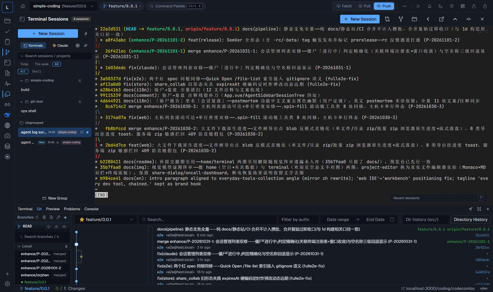
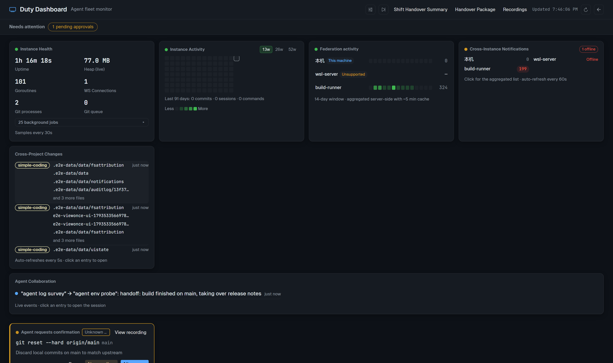
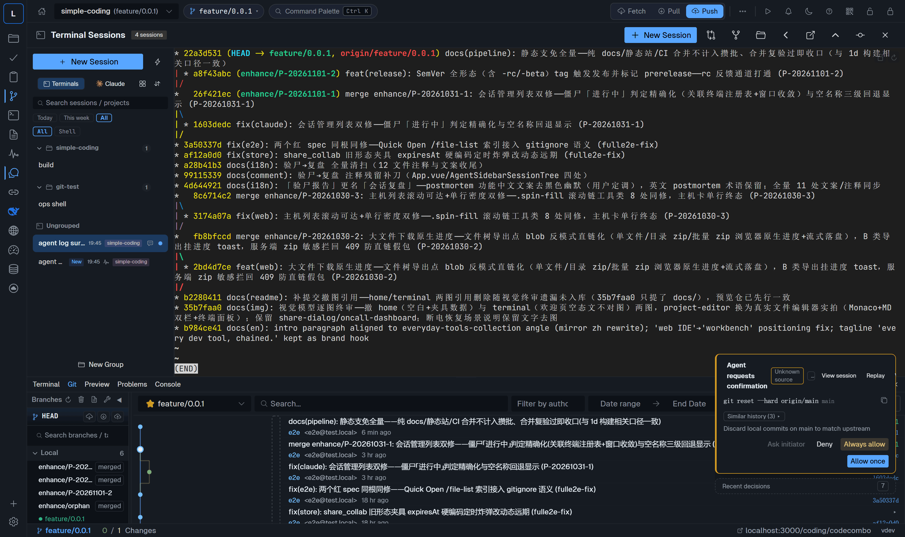
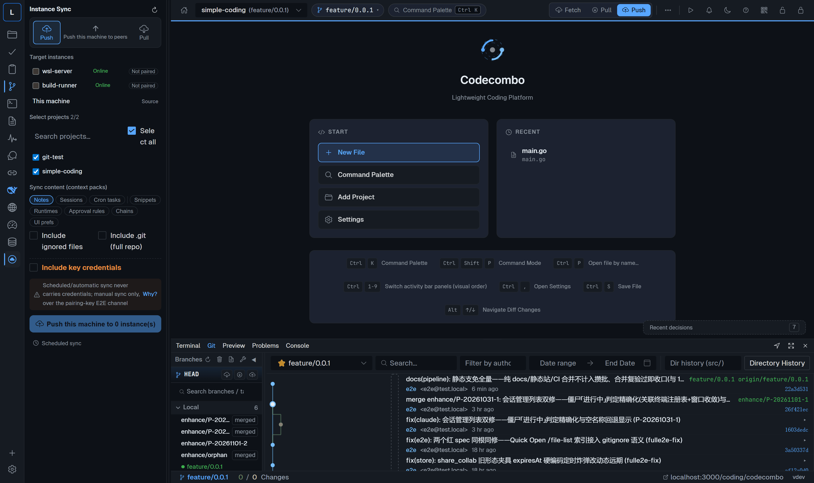
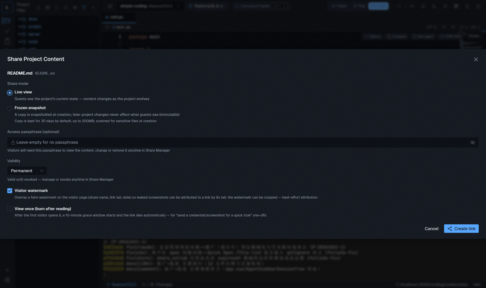
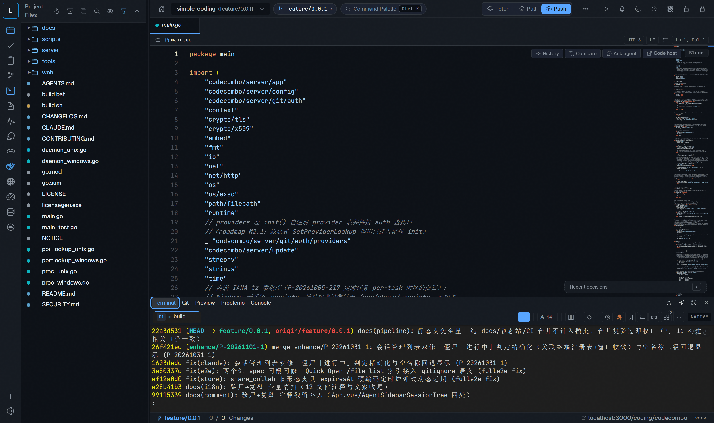

# Codecombo（简体中文）

**Language / 语言：[English](../README.md) | 简体中文**


> **状态：Beta（预览版）。** Codecombo 仍在积极开发中，尚未正式发布 1.0——
> 界面与磁盘数据格式在版本间仍可能调整。欢迎提 issue 反馈问题与建议。

**Codecombo —— 开发常用工具的一站式集合。** 自托管的单二进制 Web 工作台：
Git 工作台、真实终端会话、AI 智能体、远程主机管理，全部装进同一个浏览器
标签页——工具之间数据互通、彼此协作，不用在多个软件之间来回切换。

- **一个二进制，零外部数据库** —— Go (Gin) 后端 + Vue 3 (Naive UI) 前端经
  `go:embed` 嵌入；全部状态落在本机 `~/.codecombo/`。
- **万物皆会话** —— 本地 shell、远程 SSH 终端、AI 智能体（claude / codex /
  dsh 运行时）在同一工作区并肩工作。
- **授权委托但有刹车** —— 智能体可自主连续工作，高危动作以审批卡回到人的手上。

> **关于 dsh**：Codecombo 不包含亦不分发 dsh（DeepSeek Harness）或任何第三方
> 智能体运行时，仅提供可选的本机嵌入通道——用户自行安装 dsh 后，Codecombo
> 可经回环反代把其 Web UI 嵌入面板。详见 [NOTICE](../NOTICE)。

## 快速开始

### 一键安装（推荐）

下载最新正式版二进制 → SHA256 校验 → 装入 `~/.local/bin`（数据目录之外——
安装器绝不触碰 `~/.codecombo`，数据只归应用自己管理）并注册服务
（Linux systemd / macOS launchd / Windows 管理员时注册系统服务）——整条
命令可以直接丢给你的 AI 助手代跑：

```bash
# Linux / macOS
p=$(mktemp) && curl -fsSL --retry 3 https://raw.githubusercontent.com/wtr20211202/codecombo/main/scripts/install.sh -o "$p" && sh "$p"; rm -f "$p"
```

```powershell
# Windows PowerShell
$p="$env:TEMP\codecombo-install-$([guid]::NewGuid()).ps1";[Net.ServicePointManager]::SecurityProtocol='Tls12';(New-Object Net.WebClient).DownloadFile('https://raw.githubusercontent.com/wtr20211202/codecombo/main/scripts/install.ps1',$p);powershell -NoProfile -ExecutionPolicy Bypass -File "$p";Remove-Item "$p" -ErrorAction SilentlyContinue
```

脚本形态先把下载落进 `mktemp` 临时文件，安装前对自身做完整性自检（尾部
哨兵行，拦传输截断/代理改写的不完整下载；临时名也消除固定 /tmp 名的碰撞
与符号链接面）。`--retry 3` 兼容底线 curl 7.12+（macOS Big Sur 7.64 /
Ubuntu 20.04 7.68 / Debian 11 7.74 / RHEL 8 7.61 全可跑）；curl ≥ 7.71 可
自行加 `--retry-all-errors` 获得传输中断重试——默认命令不带，老版本 curl
遇未知选项直接硬失败。Windows 同款形态：脚本先落进 GUID 临时文件再以
`powershell -NoProfile -ExecutionPolicy Bypass -File` 执行（`Bypass` 因脚本
文件被默认执行策略拦截；显式 pin TLS 1.2 让老 .NET 也能连 GitHub），用后即
删——安装器在尾部哨兵缺失（下载不完整）或被以字符串形态（`iex`）执行时
直接拒绝运行。

**官方直连不可达时**——CN 网络到 `raw.githubusercontent.com` 连接重置/传输
中断是常态——同款安装命令可走社区镜像前缀（raw URL 前面加
`https://ghproxy.net/`；与官方命令同形态、只换 URL 前缀）：

```bash
# Linux / macOS —— 镜像回退
p=$(mktemp) && curl -fsSL --retry 3 https://ghproxy.net/https://raw.githubusercontent.com/wtr20211202/codecombo/main/scripts/install.sh -o "$p" && sh "$p"; rm -f "$p"
```

**信任边界如实说：** 尾哨兵自检 + SHA256 校验防的是传输截断/损坏，不防镜像
或链路上的恶意改写（脚本正文被改写但保留尾部哨兵即可通过校验；`SHA256SUMS`
清单与二进制同走镜像时，校验基准可被一并调包）。完整性比可用性更要紧的场
景首选官方直连或 npm 渠道（`npm i -g codecombo@next`——npm registry 自带
完整性机制）。Windows 一键命令暂无对等镜像形态（已登记跟进项）。

浏览器打开 **https://localhost:9999**，首启设置锁密码。TLS 缺省启用——自签
证书首启自动生成，浏览器首次访问需信任/继续；证书生成失败自动回落 http
（服务日志可见）。版本全自动决策：
有正式版装最新正式版；当前没有正式版时装最新 rc，没有 rc 才装最新 beta。
端口、绑定地址、安装目录与数据目录均可指定——见下方[可选参数](#可选参数)；
默认开启的端口与各自作用见[默认端口](#默认端口)。

**权限与服务运行账户。** 注册服务需要提权——Windows 用管理员 PowerShell，
Linux 用 sudo（脚本内部提权写系统文件，服务仍以**当前用户**身份运行而非
root）；macOS launchd 用户代理无需提权。不提权也能装：脚本会装好二进制并
打印手动启动命令（不注册系统服务——`start` 即后台守护运行）。服务只写你自己的数据目录（`~/.codecombo`——Windows 下经服务命令行
`--data-dir` 旗标钉死到安装者用户目录）。

**安装后改绑定/端口**：按[可选参数](#可选参数)的写法带环境变量重跑同一命令（如
`CODECOMBO_HOST=0.0.0.0`，Windows 为 `$env:CODECOMBO_HOST='0.0.0.0'`，幂等更新服务配置），
或直接管理服务。服务管理命令**各平台不同**——Windows 的
`sc.exe` 是系统自带的服务控制命令行（对应 Linux 的 `systemctl`、macOS 的
`launchctl`）：

**Windows（服务名 `Codecombo`，用 `sc.exe`）**

```powershell
sc.exe query Codecombo                # 查看状态
sc.exe stop Codecombo                 # 停止
sc.exe config Codecombo binPath= "C:\Users\<你>\AppData\Local\Programs\codecombo\codecombo.exe --serve --port=9999 --host 0.0.0.0"
sc.exe start Codecombo                # 以新绑定地址启动
```

**Linux（systemd）**

```bash
sudo systemctl status codecombo       # 查看状态
# 改 unit 内 --host 后：
sudo systemctl restart codecombo
```

**macOS（launchd）**

```bash
launchctl list | grep codecombo       # 查看状态
# 编辑 ~/Library/LaunchAgents/com.codecombo.plist 的 --host 后：
launchctl unload ~/Library/LaunchAgents/com.codecombo.plist
launchctl load ~/Library/LaunchAgents/com.codecombo.plist
```

#### 可选参数

两个安装脚本都读四个可选环境变量；不设置即取下表默认值——与此前行为完全一致：

| 变量 | 默认值 | 含义 |
|---|---|---|
| `CODECOMBO_PORT` | `9999` | 服务端口 |
| `CODECOMBO_HOST` | `127.0.0.1`（仅本机） | 绑定地址；`0.0.0.0` = 局域网可达 |
| `CODECOMBO_PREFIX` | `~/.local/bin`（Windows：`%LOCALAPPDATA%\Programs\codecombo`） | 二进制安装目录 |
| `CODECOMBO_DATA_DIR` | `~/.codecombo` | 数据目录（绝对路径）。只把路径交给服务——systemd unit / launchd plist 的 `CC_DATA_DIR`、Windows 服务命令行与打印的手动启动命令里的 `--data-dir`；安装器仍不创建、不写入它 |

写在哪：前缀在整条命令末段的 `sh "$p"` 上（写在 `curl` 前只对 curl 生效，
脚本读不到、回落默认值）；PowerShell 里在落盘一行式之前用 `$env:` 赋值——
它们在该 PowerShell 会话内一直有效，并由一行式拉起的子进程继承。

```bash
# 与已有实例并存的第二套：独立端口、数据目录与安装目录
p=$(mktemp) && curl -fsSL --retry 3 https://raw.githubusercontent.com/wtr20211202/codecombo/main/scripts/install.sh -o "$p" && CODECOMBO_PORT=11000 CODECOMBO_DATA_DIR=$HOME/.codecombo-test CODECOMBO_PREFIX=$HOME/.local/codecombo-test sh "$p"; rm -f "$p"

# 局域网访问（绑定全部网卡）——仅限可信网络，锁密码是唯一闸门
p=$(mktemp) && curl -fsSL --retry 3 https://raw.githubusercontent.com/wtr20211202/codecombo/main/scripts/install.sh -o "$p" && CODECOMBO_HOST=0.0.0.0 sh "$p"; rm -f "$p"

# 自定义安装目录
p=$(mktemp) && curl -fsSL --retry 3 https://raw.githubusercontent.com/wtr20211202/codecombo/main/scripts/install.sh -o "$p" && CODECOMBO_PREFIX=$HOME/bin sh "$p"; rm -f "$p"
```

```powershell
# Windows：与已有实例并存的第二套
$env:CODECOMBO_PORT='11000'; $env:CODECOMBO_DATA_DIR="$HOME\.codecombo-test"; $env:CODECOMBO_PREFIX="$env:LOCALAPPDATA\Programs\codecombo-test"; $p="$env:TEMP\codecombo-install-$([guid]::NewGuid()).ps1";[Net.ServicePointManager]::SecurityProtocol='Tls12';(New-Object Net.WebClient).DownloadFile('https://raw.githubusercontent.com/wtr20211202/codecombo/main/scripts/install.ps1',$p);powershell -NoProfile -ExecutionPolicy Bypass -File "$p";Remove-Item "$p" -ErrorAction SilentlyContinue
```

加装第二套实例前须知：

- **一台机器只有一个脚本托管的服务。** 服务名固定（`codecombo.service` /
  `com.codecombo` / `Codecombo`）。已有实例本身就是该服务（一键脚本装或远程
  部署装）时，带不同参数再跑会改写那个服务——接管原实例而非新增一个。此时
  第二套不走服务注册，用二进制带参数直接起：
  `<bin> start --port 11000 --data-dir <dir>`——即安装脚本跳过服务注册时
  （非管理员 PowerShell、Linux 无 sudo 凭据）打印的那条命令。
- **CLI 也要带数据目录**：`<bin> status --data-dir <dir>`、
  `<bin> stop --data-dir <dir>`。
- **升级重跑须带同样的变量**——漏了 `CODECOMBO_DATA_DIR`，改写后的服务下次
  重启回落 `~/.codecombo`（数据仍在自定义目录，只是实例不再读它）。
- **远程部署装的实例禁止重跑脚本**（见[升级](#升级)）。

#### 默认端口

默认配置（主端口 `9999`）下，运行中的实例共开四个端口。各辅助口跟随主端口
偏移（`+1` / `+2` / `+3`），除非另行配置：

| 端口（默认） | 作用 |
|---|---|
| `9999` —— 主端口 | 唯一必用口：界面、API 与终端全走 **HTTPS/WSS**。TLS 缺省启用，自签证书首启自动生成（落数据目录 `certs/`，重启复用）——浏览器首次访问需信任/继续。关闭方式：`--no-tls` 或 `CC_TLS=0` |
| `10000` —— 主端口+1 | 明文回环辅助口，仅绑 `127.0.0.1`：本机 CLI（`status`/`stop`/`restart`）与智能体回调在自签证书下继续用明文 HTTP。仅 TLS 启用时存在。改道：`loopbackPort` 配置键 |
| `10001` —— 主端口+2 | 文件分享子服务——分享出去的 `/s/…` 链接开在这个口（绑定与主端口同地址）。改道：`sharePort` 配置键 |
| `10002` —— 主端口+3 | 明文伴随口，绑主服务同地址（局域网可达）：给深度检测类网络（TLS 被拖慢）开箱即用的 http 访问面。该口凭据明文传输——关闭方式：`config.json` 配 `"httpPort": 0` |

证书信任（把 `certs/cert.pem` 装入客户端信任库）、实例互联 TLS 与伴随口
取舍的完整说明见部署文档：[deploy-linux.md §4.1](deploy-linux.md) 与
[§8](deploy-linux.md)。

**把服务形态改成明文 HTTP**（很少需要——安装器注册服务时不带 TLS 开关，
服务按缺省 TLS 启用运行）：三平台各一处改动，改完重启：

```bash
# systemd：systemctl edit 写覆盖片段，[Service] 下加 Environment=CC_TLS=0
sudo systemctl edit codecombo
sudo systemctl restart codecombo
```

```bash
# launchd：编辑 ~/Library/LaunchAgents/com.codecombo.plist，
# ProgramArguments 里加一个 <string>--no-tls</string>，然后
launchctl unload ~/Library/LaunchAgents/com.codecombo.plist
launchctl load ~/Library/LaunchAgents/com.codecombo.plist
```

```powershell
# Windows 服务：先读当前命令行，原样重设并追加 --no-tls
#（--data-dir 等其余参数保持不动），然后
sc.exe qc Codecombo
sc.exe config Codecombo binPath= "<当前命令行> --no-tls"
sc.exe start Codecombo
```

### npm 安装

```bash
npm i -g codecombo
codecombo start
```

浏览器打开 **https://localhost:9999**，首启设置锁密码（TLS 缺省启用——自签
证书，首次访问信任/继续即可；见[默认端口](#默认端口)）。需要 Node.js 18+——
npm 包只是薄包装，npm 会按平台经 optionalDependencies 自动装上对应原生二进制
（Windows / Linux / macOS，amd64 & arm64），零 postinstall 脚本。也可从
[Releases](../../releases) 直接下载二进制。

1.0 前，`npm i -g codecombo` 即最新版——每次发布（含 rc / beta 预览）都会
前移 `latest`。也可显式钉任意版本（如 `npm i -g codecombo@0.2.0-rc1`），
`@next` 恒指向最新预发布版。1.0 起稳定通道与预览通道分离：`latest` 只随
正式版前移，预发布版本（rc / beta）走 `next` 通道。npm 形态的更新归 npm 管：
应用内自更新对 npm 安装不生效——更新就是重跑安装命令。

### 升级

**安装方式决定更新方式。** 先判别装法——`systemctl cat codecombo` 看
`ExecStart` 指向的二进制路径（没有 unit 的形态——手动启动的实例（`start`
后台守护或 `--serve` 前台）或远程部署选了「直接进程」方式——用
`ps -ef | grep codecombo` 看运行中的二进制路径；`~` 即服务用户家目录，unit
里显示为绝对路径）：

| 判别依据 | 安装方式 | 升级路径 |
|---|---|---|
| `ExecStart` → `~/.local/bin/codecombo` | 上方一键脚本装 | ① 应用内自更新（首选）· ② 重跑脚本 |
| `sc.exe query Codecombo` 有结果 | Windows 一键脚本装（install.ps1，管理员运行） | ① 应用内自更新（首选）· ② 重跑 install.ps1——脚本自带停服换包 |
| `ExecStart` → `~/.codecombo/bin/codecombo` | 中心实例远程部署装 | ① 应用内自更新 · 中心实例重新远程部署 · ③ 手工替换——**禁止**重跑脚本 |
| `ExecStart` → `/opt/codecombo/bin/codecombo` | 手工 `/opt` 布局（[Linux 部署指南](deploy-linux.md)） | ① 应用内自更新 · ③ 手工替换 |
| `npm ls -g codecombo` 有结果 | npm | `npm i -g codecombo@latest`（应用内更新自动让位） |

**① 应用内自更新（推荐形态）**：版本面板（设置 → 关于）「检查更新」从
GitHub 拉取新版本、失败自动回滚。三个注意点：早于 v0.0.1-beta.3 的版本
检查链有缺陷、应用内看不到新版本（v0.0.1-beta.3 已修复）——先按下方脚本/
手工方式升一次；beta 期（尚无正式版）GitHub 正式通道恒为空，先在版本面板
打开「**跟进预发布版本**」再检查；macOS 上若曾用浏览器下载产物手工换入
二进制，该文件带 `com.apple.quarantine` 隔离属性——后台 spawn 可能被静默
拒绝，应用内更新的换包子进程起不来，更新无声卡死（应用不再回到新版本，
也不报错）。macOS 手工换二进制不要用浏览器下载产物——用 `curl` 下载或
`xattr -d com.apple.quarantine <二进制>` 清除属性；已处在此状态的实例先按
下方路径升一次——脚本装实例重跑一键脚本安全，远程部署实例必须由中心实例
重新远程部署（**禁止**重跑脚本——见上表与②的警示）。若隔离属性已清而症状
不变，则本实例非此因——见下一段 launchd 进程组案。

**macOS launchd 安装且版本为 v0.0.1-beta.9 或更早：应用内更新永远完不成。**
launchd 在 job 主进程退出时会清理整个进程组（best-effort、无实时性保证），
换包子进程在被杀之前连日志都来不及打开：应用静默回旧版本——不报错、无结果
文件，`<数据目录>/logs/update.log` 从不创建。**从 v0.0.1-beta.10 起应用内
更新可用**（换包子进程以独立进程组启动）。plist 侧的修复与二进制版本无关：
重跑一键脚本会把 `AbandonProcessGroup=true` 写入 plist 并 load，立即生效——
≤beta.9 的脚本装实例重跑后即可正常应用内升级；远程部署实例由中心实例重新
远程部署写回同键（中心实例须 beta.10+）；手写 plist 的实例自行补上该键
即可；两者都不适用则手工装 beta.10+。macOS 三种静默失败的判别式：
- 服务日志（`<数据目录>/logs/codecombo-<日期>.log`）有
  `start update process failed` → 子进程起不来（quarantine/权限）；
- 无该行、`<数据目录>/logs/update.log` 不存在、且 `<数据目录>/tmp/update-*`
  有完整下载产物 → launchd 组杀（本段所述形态）；
- `update.log` 有 `waiting for old process` → 活性/等待链问题。

自建 systemd unit 必须保留 `KillMode=process`：systemd 默认（`control-group`）
会在主进程退出时同样清理换包子进程——同一种静默失败。

脚本装（systemd 托管）的实例：更新后服务若未自行拉起，
`sudo systemctl restart codecombo` 收尾。

换包收尾按当前监管形态路由——更新前后各形态的行为差异（排障参考）：

- **systemd 托管**（一键脚本装 / 远程部署 / 手工 unit 布局）：换包完成后
  由更新子进程 `systemctl restart` 交还 systemd，状态机、`Restart=` 策略
  与日志归属不变；缺 polkit 放行规则的早期脚本装实例服务不自行拉起——
  按上一段 `systemctl restart` 收尾即可，重跑一次脚本会补装放行规则；
- **Windows 服务**（install.ps1 装）：更新期间 `sc.exe query Codecombo`
  短暂显示 STOPPED 属预期——换包在服务停驻窗口进行，完成后由更新子进程
  `sc.exe start Codecombo` 拉回，无需人工干预；健康检查失败自动回滚（先
  优雅停服再恢复旧二进制重拉，服务随即回到旧版本继续运行）；
- **macOS launchd**（install.sh 装）：换包完成后不另起进程，由 launchd
  KeepAlive 自动拉起新版本；更新健康等待为活性驱动（恢复再慢都等、不设
  时间死线：PID 基线播种防起点死旧 PID 误判、PID 连续变化 ≥2
  判崩溃循环秒级回滚、稳定存活持续探测、10 分钟失控兜底）。本版起换包后
  会先终结 KeepAlive 在换包窗口重拉起的旧实例（约一次短暂闪断，
  随后由 KeepAlive 拉起新版本）——旧实例常驻时新版永远上不了线（此前症状
  是「等待新版本就绪」卡住、或闪断后仍显示旧版本）；健康判定同时要求
  `/api/health` 通过 **且** PID 文件中的版本号等于目标版本（旧版本实例不写
  该行），故升级到本版之后的版本时无需任何手工操作；回滚时先恢复旧二进制
  再由 KeepAlive 拉回旧版本；本版起 plist 增
  `AbandonProcessGroup=true`（launchd 不再在主进程退出时清理同进程组，与
  二进制版本无关；换包子进程同时以 Setpgid 脱组，双层防组杀——≤beta.9 的
  launchd 实例组杀形态见 ① 段后的版本边界说明）；
- **`start` 后台守护 / `--serve` 前台**（手动启动、远程部署「直接进程」
  方式）：更新完成后以**原启动参数**重新拉起并转后台守护——`--host`/
  `--data-dir`/TLS 等旗标原样保留（不再静默丢失），且脱离原终端会话：
  前台启动的实例更新后关闭终端窗口不再导致服务退出；子进程 stdout/stderr
  落数据目录 `logs/update-restart.log`，更新结果注记「已转后台守护」。

**② 重跑安装脚本（仅限脚本装实例）**——重跑升级是安全的：脚本只替换
二进制与服务注册，数据目录零触碰（数据/配置/密钥全在数据目录，锁密码
也在其中，重跑后原样沿用）。原 `--host`/`--port` 读自 `ExecStart`
（装时指定过数据目录的，再从 unit 的 `Environment=` 行取 `CC_DATA_DIR`
原值、以 `CODECOMBO_DATA_DIR` 带回——带同值重跑即可），环境变量必须前缀在末段 `sh "$p"` 上（写在 `curl` 前只对 curl 生效，
端口/绑定回落默认 9999/127.0.0.1）：

```bash
sudo -v && p=$(mktemp) && curl -fsSL --retry 3 https://raw.githubusercontent.com/wtr20211202/codecombo/main/scripts/install.sh -o "$p" && CODECOMBO_HOST=<原值> CODECOMBO_PORT=<原值> sh "$p"; rm -f "$p"
```

先 `sudo -v`——脚本以 `sudo -n` 非交互探测提权，只认已缓存/免密的
凭据（没有时脚本仍会换好二进制、但跳过服务 unit 改写）。脚本经 rename
换包（服务在跑也不冲突），旧进程要等重启才换成新版本：脚本提示「检测到
正在运行的实例」时，`sudo systemctl restart codecombo` 收尾。macOS 重跑
即生效（脚本自带 launchd 代理重载）。**远程部署装的实例禁止重跑脚本**——
unit 被模板覆写会丢 `PATH`/`WorkingDirectory`/`NoNewPrivileges` 且绑定缩回
`127.0.0.1`，服务一重启远程访问即断；该布局走应用内更新或中心实例重新远程
部署（中心实例须 v0.0.1-beta.3 及以上——更早的部署器覆盖升级旧实例可能失败）。
Windows 重跑 install.ps1 用管理员 PowerShell，并带上与原安装相同的
`$env:CODECOMBO_*` 值（当前 `--port`/`--host`/`--data-dir` 见
`sc.exe qc Codecombo` 的 `BINARY_PATH_NAME` 行）——脚本自带停服换包
（Windows 锁定运行中的 `.exe`，服务在跑换包必败；非管理员重跑撞上
运行中的服务会快速失败并给出同样的提示）。

**③ 手工替换二进制（仅 Linux）**：完整配方（stop → SHA256 校验 → 留
`.bak` 备份 → 替换 → start，含回滚步）见 [Linux 部署指南](deploy-linux.md)
§6；服务起不来的 `status=203/EXEC` 三态诊断见同篇 §7。注意文件体积：二进制
约 50MB 量级（linux-amd64 约 51–54MB），只有几十字节说明点成了
`.sha256`/`.sig` 伴随资产。

### 更新链代理

更新链（版本检查与二进制下载）按固定档序逐请求选出站路径——
**显式设置 > 环境变量 > 系统代理自动探测（开关开时）> 直连**：

1. **显式设置**——设置项 `updateProxy`，版本面板（设置 → 关于）
   「更新代理」输入框。支持 `http://` / `https://`（CONNECT 隧道）与
   `socks5://`（`socks5h` 同义）——公司内网代理与本地 clash 客户端端口
   （`127.0.0.1:…`）正是目标场景。显式代理对更新链全量生效，
   不解读 `NO_PROXY`。
2. **环境变量**——标准 `HTTPS_PROXY` / `HTTP_PROXY` / `NO_PROXY` 语义
   （含小写变体）。服务器场景写在 systemd unit 的 `Environment=` 行，
   改后重启服务即生效（示例见 [Linux 部署指南](deploy-linux.md) §3）。
3. **系统代理自动探测**——版本面板「自动探测系统代理」开关（设置项
   `updateProxyAutoDetect`，默认关）。上面两档都未给出代理时，
   更新链改用本机桌面系统代理：Windows Internet 设置、
   macOS 网络设置（scutil）、Linux GNOME（gsettings）——只认静态代理，
   PAC/WPAD 自动配置脚本不求值。探测档尊重 `NO_PROXY`（命中的目标直连）。
   探测只发生在启动、设置保存与更新尝试三类挂点，绝不逐连接探测——
   开着开关不增加每次请求的延迟。
4. **直连**——以上皆无时保持直连，拨号期内网/保留 IP 守卫原样生效。

两个代理设置都绑定本机网络拓扑：不进设置同步/迁移，
多实例场景按实例分别设置。

排障「更新到底走的哪条路」：版本面板代理设置旁有「**当前生效**」档位展示；
程序化口径是 `GET /api/updates/proxy-status`——返回 `tier`
（`explicit` / `env` / `sysdetect` / `direct`）、生效代理地址（凭据已脱敏）、
开关态与最近一次探测结果；`?refresh=1` 即时重新探测（开关关仍零探测）。
在本实例已解锁的浏览器里直接打开该地址，
或用 `Authorization: Bearer sc_…` 访问令牌头调用。

安全口径一句：任一代理档生效时更新目标由代理解析，
拨号期 IP 守卫由官方域白名单替代
（GitHub 官方更新域 ∪ 显式配置的更新源 host），逐跳（含重定向）校验。

### 从源码构建

前置要求：Go 1.26+、Node.js 20.19+ / 22.12+、Git。

```bash
git clone https://github.com/wtr20211202/codecombo.git
cd codecombo

./build.sh            # Linux/macOS —— 前端 + Go，产物在 dist/
build.bat             # Windows

./dist/codecombo start        # 后台守护进程方式启动
```

浏览器打开 **https://localhost:9999**，首启设置锁密码（TLS 缺省启用——自签
证书，首次访问信任/继续即可），添加本地 Git 项目或克
隆远程仓库。Windows / Linux / macOS（amd64 & arm64）预编译二进制见
[Releases](../../releases)。

### 开发模式

```bash
cd web && npm install && npm run dev   # Vite 开发服务器 :5173（代理到 :9999）
go run main.go                         # Go 后端 :9999（第二个终端）
```

提交改动前跑质量门禁：`cd web && npm run check`（类型检查 + lint + 单测 +
契约门禁）与 `go test ./...`。

### 局域网访问（其他设备）

默认只绑定 `127.0.0.1`（仅本机可达）。想让手机或局域网内其他机器访问，
绑定全部网卡：

```bash
codecombo start --host 0.0.0.0        # 或 -H 0.0.0.0（旗标优先于 config.json 的 server.host）
```

然后在其他设备打开 `https://<本机IP>:9999`（TLS 缺省启用——首次访问信任
自签证书即可；深度检测网络拖慢 TLS 时有明文伴随口兜底，见
[默认端口](#默认端口)）。首启设置的锁密码就是访问闸门
——请只在可信网络下绑定 `0.0.0.0`。

## 新手上路

上面的章节管「装好」，这一节管「装好后干什么」——十分钟从空实例走到真实
产出，每一步都是既有能力，细节见[工具箱一览](#工具箱一览)与
[特色能力](#特色能力)。

**1. 打开工作台，设好锁。** 浏览器打开 **https://localhost:9999**，首启设置
锁密码（TLS 缺省启用——自签证书，首次访问信任/继续即可）——它是每次访问的
闸门，另有闲置自锁兜底。

**2. 添加项目——这件事也可以交给智能体。** 在主页添加本地 Git 仓库（或直接
克隆一个）。也可以整步跳过——工作台为你准备的捷径：先开一个**智能体会话**
（无需项目，任意目录皆可，缺省用户主目录），在聊天里直接让它把你的项目加
进来。智能体经 ops 通道操作工作台本身：添加项目（`POST /api/projects`）就
写在它的手册里（`GET /api/ops-manual`），会话环境开箱即带 `CC_LOCK_TOKEN`
调用凭据。两条底线：项目路径必须是 Git 仓库（智能体可以先 `git init` 或
克隆一个）；高危动作仍以审批卡回到你的手上。

**3. 给智能体下第一件事。** 在会话里直接说：跑一遍测试、修这个 bug、写那个
功能。会话按首条任务自动命名；每个会话都是真实 PTY——刷新页面即可完整回放
输出，支持行级书签与全量检索。

**4. 裁决高危动作。** 智能体没有空白支票：遇到高危命令或批量文件替换，一张
审批卡带着终端实况录制回到工作台——先看它做了什么，再逐项放行、拒绝或
改写。

**5. 等它干活的间隙，顺手试两件事。** 任意文件右键 → **分享**：一键短链
（TTL / 口令 / 阅后即焚），访客无需账号即可打开。再打开**笔记库**——你和
智能体共享的记事本：让智能体把交接笔记沉淀进去，下一个会话接着上一棒干。

到这里，下面的[工具箱一览](#工具箱一览)是其余能力的全图，
[特色能力](#特色能力)逐项有更深的展开。

## 工具箱一览

| 工具 | 能做什么 |
|---|---|
| **Git 工作台** | 可视化 Git：hunk 级暂存、三路差异、拖拽交互变基、合并预演、冲突解决、worktree、子模块、LFS、GPG 签名提交、可 cherry-pick / squash / extract 的提交图 |
| **Web 终端** | 真实 PTY（ConPTY / pty）、可选 tmux 持久会话（重启后输出回放）、分屏、浮动窗、粘贴图片直传、书签、命令块 |
| **远程主机** | SSH 主机托管（凭据加密）、远程终端（含远端 tmux）、一键远程部署流水线（建用户 → 运行时 → systemd 服务）、部署日志实流、端口穿透 |
| **AI 智能体会话** | claude / codex / dsh 多会话——双智能体同题对比、接续链、定时任务、可复用运行书、舰队执行；会话按首条任务自动命名、可归入自定义分组、断电重启后按原状恢复；每个会话真实 PTY，输出全程可回放 |
| **智能体操作通道** | 智能体经结构化 API 操作工作台本身：弹下载、写剪贴板、按行号开文件、预览链接、ask 卡与审批卡、跨设备通知 |
| **审批中心** | 高危命令与批量替换以审批卡回流，附终端实况录制——逐项放行 / 拒绝 / 改写；敏感值出域前脱敏 |
| **笔记库** | 人机共享 notepad——唯一项目无关笔记库；智能体经 ops 通道读写同一座库，沉淀交接篇，下一个会话接着上一棒干 |
| **TODO 清单** | 代码注释 TODO / FIXME / XXX / HACK 标记聚合一屏——人类留给下一轮智能体工作的「赊账清单」 |
| **变更流** | 跨项目文件变更实时时间线——值班大屏卡之外、工作台内「刚才哪里都改了什么」的入口 |
| **环境画像** | 每项目一张只读「环境简历」：终端探测/智能体上报的 dev 端口、可见输出哨兵规则、部署目标主机——新人（人或智能体）接手免翻终端历史猜端口 |
| **值班大屏** | 一屏看清实例健康（内存 / goroutine / git 压力）、52 周活动热图、实时变更流、智能体协作流、停滞会话分诊 |
| **多实例同步** | 一屏管理本机与远程实例：健康总览切换、终端/面板接管、实例间同步、口令加密整机迁移（`.scpkg`） |
| **访客分享** | 文件 / 目录 / 片段 / 实时终端一键短链——TTL、口令、阅后即焚、定格快照；访客零账号 |
| **dsh 接入** | dsh（DeepSeek Harness）Web UI 经回环反代嵌入 + npm 版本管理：升级 / 回退与版本 changelog |
| **安全底座** | 全局锁（首启设密、闲置自锁）、敏感字段 master-key AES-256 加密落盘、IP 限流、审计日志 CSV 导出 |
| **自更新** | 基于 GitHub Release 的更新检查与失败自动回滚；中心实例可缓存转发二进制 |
| **双语与主题** | 简体中文 / English 界面；Dark / Light / One Dark / Dracula 四主题 |

各工具细节与截图见[特色能力](#特色能力)。

## 特色能力

以下每模块收敛为摘要+截图；完整走读与逐模块指南在官网文档——[快速上手](https://wtr20211202.github.io/codecombo/guide/getting-started.html?lang=zh-CN) ·
[功能全览](https://wtr20211202.github.io/codecombo/guide/features.html?lang=zh-CN) ·
[常见问题](https://wtr20211202.github.io/codecombo/guide/faq.html?lang=zh-CN)（仓内源文件：[site/guide/](../site/guide/)）。

### 智能体操作通道

别的终端没有的部分：智能体不只是「跑在」Codecombo 里——还能经结构化 API
**操作这台工作台本身**：把结构化提问（ask 卡）与高危操作请求（审批卡）带回
给你裁决，弹下载、写剪贴板、按行号开文件、预览链接、跨设备通知走同一条通道。
全部能力登记在单一注册表并渲染为智能体可读的手册（`GET /api/ops-manual`）。

详情 → [官网文档](https://wtr20211202.github.io/codecombo/guide/features.html?lang=zh-CN#agent-sessions) · [仓内源文件](../site/guide/features.html#agent-sessions)

### 智能体会话

单项目并行多个智能体会话——双智能体同题对比、会话接续链、定时智能体任务、
可复用运行书、舰队执行。每个会话都是真实 PTY：刷新页面后完整回放 scrollback。



详情 → [官网文档](https://wtr20211202.github.io/codecombo/guide/features.html?lang=zh-CN#agent-sessions) · [仓内源文件](../site/guide/features.html#agent-sessions)

### 值班大屏

一块屏幕回答「我的机器现在怎么样」：实例健康（内存 / goroutine / WS 客户端
/ git 进程压力）、52 周活动热力图、跨项目实时变更流、智能体协作流、会话
停滞分诊、待裁决审批卡。



详情 → [官网文档](https://wtr20211202.github.io/codecombo/guide/features.html?lang=zh-CN#oncall) · [仓内源文件](../site/guide/features.html#oncall)

### 审批中心

智能体没有空白支票：高危命令与批量文件替换以审批卡回流，附终端过程实况录制
——先看它做了什么，再逐项放行/拒绝/改写。敏感值（token / 密码 / 云 key）出
域前统一脱敏。



详情 → [官网文档](https://wtr20211202.github.io/codecombo/guide/features.html?lang=zh-CN#approvals) · [仓内源文件](../site/guide/features.html#approvals)

### 多实例同步

一个 Codecombo 实例可管理多个其他实例（本机或远程）：集中代理的实例切换与健
康总览、远程实例的终端与面板接管、实例间同步、换机一次性迁移（口令加密的
`.scpkg` 配置包导出/导入，携带凭据、设置与项目上下文）。



详情 → [官网文档](https://wtr20211202.github.io/codecombo/guide/features.html?lang=zh-CN#sync) · [仓内源文件](../site/guide/features.html#sync)

### 访客分享链接

文件、目录、文本片段、甚至实时终端，一键生成分享链接——TTL / 口令 / 阅后即焚 /
定格快照各是一个开关；访客侧零账号。

实时终端分享默认只读并经开遮蔽处理；分享者可额外开启**访客输入**（开放直入或
申请-批准）。该可写模式页面常驻**「上传文件/图片」按钮**——全浏览器与移动端
可用：图片压缩、类型与大小白名单同链，落盘后把路径键入终端。**点击终端聚焦
后 Ctrl+V 已可用**：文件走上上传链，纯文本经终端输入通道粘贴（与键入同一条
命令审批/审计链）。取舍是 Ctrl+V 不再作为字面 `^V` 转发给主机，终端内绑定该
键的程序（如 Vim 块选择）不再收到它。Ctrl+V 送文件仍取决于浏览器：Firefox
从文件管理器复制文件不会填充 `clipboardData.files`，iOS Safari 无法粘贴文件，
桌面 Safari 灰显，Android Chrome 受剪贴板权限影响；剪贴板里确有图片时页面还会
额外尝试一次显式剪贴板读取作兜底。移动端或其余浏览器另可在分享者已开启协作时
使用协作素材入口（拍照 / 选择文件）；可写页上的拖拽不会上传任何文件——页面会
拦截缺省导航并提示改用上传按钮或 Ctrl+V。



详情 → [官网文档](https://wtr20211202.github.io/codecombo/guide/features.html?lang=zh-CN#sharing) · [仓内源文件](../site/guide/features.html#sharing)

### 以及一个完整的 Git 工作台

hunk 级暂存与丢弃、三路差异、拖拽式交互变基、合并预演、changelist 分组与搁
置、冲突解决、worktree、子模块、LFS、GPG 签名提交、reflog、补丁导出导入、
可 cherry-pick / squash / extract 的提交图。



详情 → [官网文档](https://wtr20211202.github.io/codecombo/guide/features.html?lang=zh-CN#git-workbench) · [仓内源文件](../site/guide/features.html#git-workbench)

### 工具箱其余部分

- **dsh 接入** —— dsh（DeepSeek Harness）Web UI 经回环反代嵌入；npm 版本
  管理：升级 / 回退与版本 changelog。
- **Web 终端** —— 真实 PTY（Windows ConPTY / Unix creack/pty），可选 tmux
  持久会话（重启后恢复输出），分屏、浮动窗、粘贴图片直传、书签、命令块。
- **远程主机** —— SSH 凭据加密托管、远程终端（含远端 tmux）、一键远程部署
  流水线、部署日志实流、端口穿透。
- **安全底座** —— 全局锁（首启设密、闲置自锁）、全部敏感字段经本机
  master-key AES-256 加密落盘、IP 限流、审计日志与 CSV 导出。
- **自更新** —— 基于 GitHub Release 的更新检查与失败自动回滚；中心实例可
  缓存转发二进制给子实例。零配置：官方仓库即内置默认更新源；自动检查每 24
  小时一轮，新版本可用时推送通知，版本面板可关闭。走哪条升级路径取决于安装
  方式——见[升级](#升级)；官网文档功能全览的模块条目：
  [官网文档](https://wtr20211202.github.io/codecombo/guide/features.html?lang=zh-CN#more) ·
  [仓内源文件](../site/guide/features.html#more)。
- **双语与主题** —— 简体中文 / English 界面；Dark / Light / One Dark /
  Dracula 四主题。

## 项目结构

```
codecombo/
├── main.go                  # CLI 入口（start/stop/update/reset-lock/credential-helper）、守护进程、嵌入
├── server/
│   ├── api/                 # HTTP/WS API 层（admin / gitops / notify / shared）
│   ├── git/                 # Git CLI 封装（execGit + 鉴权注入 + 写队列）
│   ├── terminal/            # PTY 会话管理（native / tmux 后端）
│   ├── deploy/              # 远程部署引擎（Deployer 注册表 + 任务管理器）
│   ├── sync/                # 多实例同步 + 换机迁移（.scpkg）
│   ├── share/               # 访客分享链接（文件/片段/终端）
│   ├── config/              # 配置存储、master-key 加密、数据目录迁移
│   ├── store/               # JSON 持久化（按领域拆分的 store）
│   └── ...                  # metrics / notification / proxy / update / watch / recording
├── web/                     # Vue 3 + TypeScript 前端（go:embed 嵌入）
│   ├── src/views/           # 面板：git、终端、编辑器、智能体、值班大屏、设置
│   ├── src/components/      # UI 组件（layout / monitor / recording / ...）
│   └── e2e/                 # Playwright 端到端测试
├── docs/                    # 架构与设计文档（中文，英文化在 Roadmap）
├── scripts/                 # 开发/测试工具（e2e 编排、质量门禁）
└── build.sh / build.bat     # 跨平台构建（6 个目标）
```

## 文档索引

两处入口，按读者划分：

**官网用户文档**（中英双语），即上文特色能力逐项链接的同一组页面：

- [快速上手](https://wtr20211202.github.io/codecombo/guide/getting-started.html?lang=zh-CN) —— 安装 → 首启设锁 → 添加项目（或让智能体代办）→ 重启不丢现场 → 分享与笔记 · 仓内源文件：[site/guide/getting-started.html](../site/guide/getting-started.html)
- [功能全览](https://wtr20211202.github.io/codecombo/guide/features.html?lang=zh-CN) —— 工作台全部模块一页过：每个模块是干什么的、在工作台哪里找到它 · 仓内源文件：[site/guide/features.html](../site/guide/features.html)
- [常见问题](https://wtr20211202.github.io/codecombo/guide/faq.html?lang=zh-CN) —— 端口与访问、数据与备份、升级路径判别、锁与远程访问、常见报错（203/EXEC 等） · 仓内源文件：[site/guide/faq.html](../site/guide/faq.html)

**内部架构文档**（贡献者向），位于 [`docs/`](./)——中文撰写，英文化在 Roadmap：

- [智能体会话编排](AGENT_SESSIONS.md) —— 智能体会话、审批、编排原语与 ops 手册按运行时注入（claude / codex 自动注入、dsh 手动）
- [扩展点索引](EXTENSION_POINTS.md) —— kernel 模块 / Deployer / 平台适配 /
  前端面板 / ops 事件 / filepolicy
- [持久化三车道](PERSISTENCE_LANES.md)
- [ops 事件目录](OPS_EVENTS.md) —— 智能体可订阅/广播的事件契约
- [架构决策记录](adr/README.md)
- [Linux 部署指南](deploy-linux.md)
- [远程访问与安全](remote-access.md)

## Roadmap

- [ ] 文档渐进英文化（按热度）
- [ ] SQLite 可选存储后端——按用户反馈评估；开源前刻意不实施
- [ ] CI 扩 macOS（当前 Windows + Linux）
- [ ] 基于既有扩展点的插件 API

## 贡献

**欢迎提交 Pull Request**——Bug 修复、文档与新功能一概欢迎。非琐碎改动请先开
[Issue](../../issues) 对齐方向；提交请带 DCO 签名（`git commit -s`）并确保测试门禁通过。
开发环境搭建见 [CONTRIBUTING.md](../CONTRIBUTING.md)。请保持讨论区友善、切题。

## 安全

安全漏洞请走 [GitHub Security Advisories](../../security/advisories/new)
私密上报，勿开公开 Issue。见 [SECURITY.md](../SECURITY.md)。

## 许可证

[Apache License 2.0](../LICENSE)。随仓分发的字体与 vendored 资产各有其许
可，清单见 [NOTICE](../NOTICE)。
